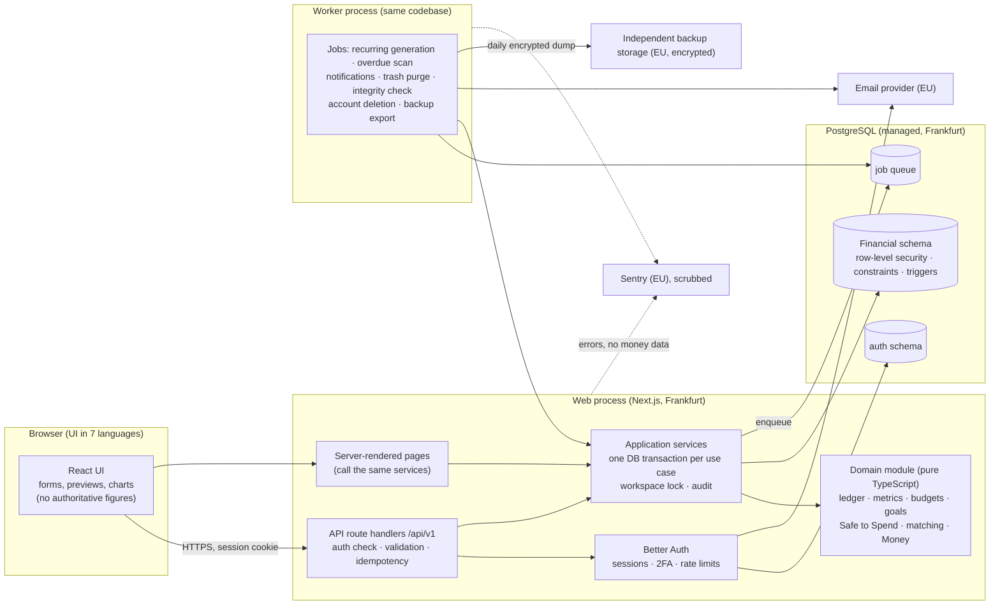
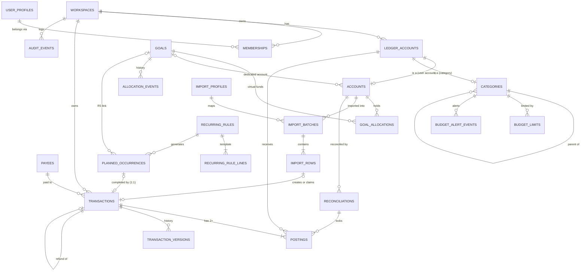

# Personal Finance Tracker — Stage 2 Architecture and Technical Design

**Status:** ✅ **Stage 2 approved on 2 Nov 2026** · Stage 3 not started (needs your go-ahead) · the Safe to Spend user test is planned, not yet run · **nothing is implemented**

This document consolidates the Stage 2 package (Parts 1 and 2 and the resolution of the open questions) with every approval merged in. It builds on [stage-1-specification.md](stage-1-specification.md), which remains the source of truth for financial rules. The main sections are binding; Annex R keeps the reasoning.

## 1. Executive summary (one page)

**The design in one sentence.** A single TypeScript application, deployed as a web process and a worker process from one codebase, using one PostgreSQL database in Frankfurt. Every financial rule lives in one framework-free domain module, tested by the 71 golden tests.

| Area | Approved decision |
|---|---|
| Stack | TypeScript; Next.js UI and versioned JSON API (`/api/v1`); pure domain package; PostgreSQL; Drizzle with reviewed SQL migrations; Postgres-backed job queue (AD-01, AD-03, AD-09, AD-10) |
| Hosting | Render, Frankfurt, Pro workspace: web, worker, managed Postgres with 7-day point-in-time recovery (AD-02) |
| Authentication | Better Auth in our own database: Argon2id, database sessions with no cookie cache, re-authentication within 10 minutes for sensitive actions, Pwned Passwords check, 2FA at launch (optional) (AD-04, AD-15, AD-19) |
| Sessions | Idle 30 minutes (14 days with "keep me signed in"); absolute 30 days; revocation is immediate (AD-14) |
| Isolation | Application checks **and** forced row-level security **and** composite workspace foreign keys (AD-05) |
| Integrity | Integer cents in `BIGINT`; balancing checked at commit; one database transaction per action; writes serialized per workspace; idempotency keys; no stored balances (AD-06 to AD-08, AD-17) |
| Currency | EUR or USD per workspace (CUR-1), enforced by the database (AD-20) |
| Email | Scaleway Transactional Email; Amazon SES as fallback (AD-12) |
| Backups | Provider point-in-time recovery, plus a daily encrypted copy in Hetzner Object Storage (Germany) with object lock (AD-13) |
| Monitoring and privacy | Sentry in the EU with scrubbing; no amounts in logs; no tracking scripts; no admin screen that shows user data (AD-11, AD-21, OD-13) |
| Encryption | At rest: confirmed in Render's DPA. In transit: TLS 1.2+ |
| Market and languages | EU first (MKT-1); UI in English, Bulgarian, German, Spanish, Italian, French and Greek, switched on in phases: **English only at launch** (MKT-2, AD-22, §18). Bank/card connection in release 1.1 (AD-23) |

**Estimated early cost:** about **$99/month** for production plus staging, and about **$128** once Sentry's paid tier is needed (§3.4).

**Before public launch:** review Render's SOC 2 report (needs the Pro plan and Render's NDA); sign the DPAs; lawyer review of the legal documents and questions (Annex L, LQ-01 to LQ-08); the first restore drill (gate G3); an external penetration test.

**Next:** Stage 3 (ledger core, login and data isolation) when you give the go-ahead. The Safe to Spend user test (§17.2) runs before the Stage 5 UI is finalized.

**Where to look**

| Need | Section |
|---|---|
| Requirements that shape the design, contradictions, rule gaps | §2 |
| Stack, hosting and costs | §3 |
| Architecture diagram and data flows | §4 |
| Database tables and ERD | §5, §6 |
| Money, atomicity, concurrency | §7 |
| Security and isolation tests | §8 |
| API | §9 |
| Calculation modules | §10 |
| Backups, retention, imports, export | §11 |
| Testing strategy | §12 |
| Deployment | §13 |
| Decision register | §14 |
| Open items and readiness | §15, §16 |
| Wireframes, user-test plan, advertising concept | §17 |
| Localization (7 languages, phased) | §18 |
| Legal and trust plan | Annex L |
| How open questions were resolved | Annex R |

---

## 2. Stage 1 requirements that shape the architecture

### 2.1 Approved decisions that constrain the design

| Stage 1 source | Requirement | Architectural consequence |
|---|---|---|
| LR-01 to LR-04, §2.3 | Double-entry ledger; postings sum to 0; all postings share one date | `transactions` and `postings` tables. Balancing is enforced by the database at commit, not only by code |
| LR-07, LR-08, LR-09 | Planned items and allocations never post; only posted, non-voided transactions count | Planned occurrences and allocations live in separate tables from postings. Metrics query only active postings |
| LR-10, LR-11, FR-19 | Edits replace postings and store versions; voids instead of reversal entries; 30-day trash; audit | Version table, status lifecycle, append-only audit, and a purge job |
| LR-16 | One source of truth for every figure | All figures come from one calculation module; the UI never calculates authoritative values |
| LR-17, NFR-02, §10 | Integer cents; no floating point | `BIGINT` minor units; a Money value type in the domain module |
| FR-02, BR-02.1 to BR-02.6 | Workspaces own the data; two isolation layers; unguessable IDs; "not found" for other users' data | Workspace ID on every row; row-level security; composite foreign keys; random UUIDs |
| CUR-1, FR-23 | EUR or USD per workspace, locked after the first transaction; future multi-currency possible | A currency code on every posting, tied to the workspace's currency by the database |
| §7 (F3, AM-1, option c, R1–R8) | Safe to Spend is fully specified | A pure, testable Safe to Spend module. **No formula is invented in this design** |
| §9.5 M-1 to M-8, BR-16.x | Matching, fingerprints with ordinals, one-to-one claiming, undo import | Import tables; a unique index on fingerprints; claim columns with unique constraints |
| FR-18 | Reconciled items are locked | A reconciliation link per posting; database triggers block edits to locked rows |
| NFR-01 | A nightly integrity job | A worker job that recomputes and checks the invariants, with alerts |
| NFR-03, NFR-11 | Dashboard p95 < 1.5 s at 50,000 transactions; up to 100,000 transactions over 10 years | Index design that lets balances be summed straight from the index. Caching only if measured to be necessary |
| NFR-05 | RPO ≤ 1 h, RTO ≤ 8 h, quarterly restore tests | Managed point-in-time recovery plus an independent daily backup copy |
| NFR-07, NFR-12, PRV-04 | No trackers; no amounts in logs | A log redaction policy; PII scrubbing in Sentry; no analytics SDKs |
| FR-16, BR-16.7 | CSV import up to 10,000 rows; the raw file is discarded | Parse in memory, store only the parsed rows, no file storage |
| §12.2, AP-15 | Build order: ledger core → core app → import → planning | The schema is built in slices through migrations |

### 2.2 Contradictions in the inputs

| # | Contradiction | My handling | Status |
|---|---|---|---|
| X-1 | Stage 2 brief §5 says EUR only in v1; CUR-1 says EUR or USD per workspace in the MVP | Design for CUR-1 (ASM-1). The schema allows either, so falling back to EUR only means narrowing one list | ✅ Approved: CUR-1 replaces the brief's "EUR only" |
| X-2 | SEC-01 lists 2FA as Must; FR-01, A-6 and §3.6 list it as Should | The auth library includes TOTP, so the cost of making it Must is small. **2FA available at launch and optional for users** | ✅ Approved (AD-15) |
| X-3 | BR-01.5 points to session values in §11, which has none | Values in §8.2 | ✅ Approved (AD-14) |
| X-4 | NFR-03 assumes 50,000 transactions; NFR-11 implies up to 100,000 | Design and performance-test at 100,000 | Resolved (larger figure used) |

### 2.3 Open Stage 1 decisions that affect the design

| ID | Question | Effect on the design | Handling |
|---|---|---|---|
| OD-17 | More than one workspace per user? | The schema supports many workspaces through memberships. Only the UI and onboarding would change | Not blocking |
| ~~OD-16~~ | English sooner? | **Closed by MKT-1 and MKT-2:** 7 languages, switched on in phases. See §18 | — |
| OD-13 | Support access to user data | Decides whether a "break-glass" database role exists | ✅ Approved: break-glass only, with consent (§8.4) |
| OD-05 to OD-07 | Retention periods | Settings for the purge jobs | Defaults used; legal check pending |
| D-7 | Target audience | No technical effect | — |

### 2.4 Small rule gaps found while designing

I haven't changed any accounting rules. These are gaps where the specification doesn't say what happens. Each has a proposed default that needs your yes.

| # | Gap | Proposed default |
|---|---|---|
| GAP-1 | Trashing (not voiding) a transaction that's linked to a planned occurrence | The occurrence returns to Planned, exactly as with a void (§9.3) |
| GAP-2 | A refund whose original transaction is later purged from the trash | The refund stays; its link is cleared; the audit records it |
| GAP-3 | No upper limit on amounts | Each posting is limited to ±999,999,999,999 minor units (just under €10 billion). Larger amounts are rejected |
| GAP-4 | How long the undo toast stays available | 10 seconds. After that, the edit history and trash are the way back |
| GAP-5 | A cancellation window after an account-deletion request | 7 days to cancel, then the purge starts (still within OD-07's 30 days) |
| GAP-6 | Two devices editing the same transaction | The second save is rejected with "changed elsewhere, reload". This is technical behaviour, not an accounting rule |

---

## 3. Technology stack

### 3.1 Options compared

| | **A. TypeScript modular monolith** (Next.js + Postgres) | **B. Python/Django monolith** (Django + Postgres, server-rendered pages with HTMX) | **C. Backend-as-a-service** (e.g., Supabase, with the client querying the database directly under row-level security) |
|---|---|---|---|
| **Advantages** | One language for UI, API and rules. Validation schemas shared between client and server. Strong UI ecosystem for import review, split editing and charts. Mature i18n | Batteries included: authentication, Argon2 hashing ([Django docs](https://docs.djangoproject.com/en/stable/topics/auth/passwords/)), CSRF protection, migrations, mature database transaction handling, native decimals | Fastest start. Authentication, database and APIs bundled |
| **Disadvantages** | Authentication, migrations and job processing have to be assembled from libraries. The framework changes frequently. Server-component caching rules need discipline. Middleware is not safe for authorization, as shown by [CVE-2025-29927](https://vulnerability.cert.dk/vuln/cve-2025-29927) | Rich interactive screens are harder with server-rendered pages. Adding React later means two languages. No types shared with the client | Business logic ends up in database functions or the client. That conflicts with "the backend is authoritative", is hard to test with golden tests, and creates vendor lock-in |
| **Development complexity** | Medium | Low to medium (low for forms, higher for rich UI) | Low at first, high for correctness |
| **Maintenance** | Medium: dependency updates, framework upgrades | Low to medium: stable LTS releases | Medium: vendor changes |
| **Security** | Good when authorization sits in the service layer and the database (never in middleware). The library-based auth must be configured carefully | Very good defaults | Row-level security becomes the *only* barrier, and one wrong policy exposes data |
| **Early-stage cost** | About $99/month (§3.4) | About the same (same hosting) | Similar or lower |
| **Future growth** | Good. The domain module can be extracted, and the API can serve a future mobile app | Good | Limited by the vendor's model |
| **Verdict** | ✅ **Recommended** | Strong alternative | ❌ Rejected: conflicts with the requirement that calculations run on the trusted backend |

**Why A, honestly.** The deciding factor isn't popularity. This product's riskiest screens are interactive: import review with matching suggestions, the split editor, the Safe to Spend breakdown, and responsive charts with table equivalents. Option A handles those best, and it lets the domain module be shared, so the UI can *preview* the same rules the server *enforces*.

Option B would be safer on security defaults, and I'd recommend it if most screens were simple forms. The Stage 1 direction already pointed to TypeScript, but I've judged it on these merits rather than on that.

### 3.2 Recommended components (Option A)

| Concern | Recommendation | Notes |
|---|---|---|
| UI | Next.js (React, App Router) with TypeScript; server-rendered pages; next-intl with ICU messages for 7 languages (§18) | Authorization never lives in Next.js middleware (AD-16) |
| API | Versioned JSON API (`/api/v1/…`) as route handlers in the same app | Thin handlers that call application services |
| Domain | A framework-free TypeScript package: ledger, metrics, Safe to Spend, goals, matching, Money and rounding | Pure functions, no I/O; this is where the golden tests run |
| Validation | Zod schemas shared by client and server; the server always re-validates | — |
| Database | PostgreSQL (managed), one database, Frankfurt | — |
| Data access and migrations | Drizzle ORM plus drizzle-kit, generating **plain SQL migration files** that are reviewed and committed; hand-written SQL for row-level security, triggers and constraints | Migrations stay readable SQL; there's no hidden schema magic |
| Background jobs | A Postgres-backed job queue (for example pg-boss or graphile-worker, to be chosen in Stage 3), run by the worker process | No Redis, so one less service to run |
| Authentication | Better Auth (see §8) | — |
| Email | **Scaleway Transactional Email** (France, EU-hosted); Amazon SES Frankfurt as fallback | ✅ Approved (AD-12, §8.9) |
| Errors | Sentry, EU data region (Frankfurt) | [Fact] EU storage is in Frankfurt and is chosen at organization creation; it can't be changed later ([Sentry docs](https://docs.sentry.io/organization/data-storage-location/)) |
| Testing | Vitest (unit and integration), real Postgres in CI, Playwright (end-to-end), fast-check (property tests) | Mapping in Part 2, §12 |
| Charts | Recharts or ECharts, always with a table equivalent (NFR-08) | — |
| Code hosting and CI | GitHub (private) with GitHub Actions (ASM-5) | — |

### 3.3 Hosting options compared

| | **Render, Frankfurt** (recommended) | **Vercel + Neon** (both with EU regions) | **EU-owned provider** (e.g., Scaleway, Hetzner) |
|---|---|---|---|
| Model | Long-running web service and worker; managed Postgres in the same private network | Serverless functions plus serverless Postgres | Containers or VMs plus managed or self-run Postgres |
| EU region | [Fact] Frankfurt is Render's only EU region, and the region can't be changed after creation ([Render regions](https://render.com/docs/regions)) | [Fact] Neon offers Frankfurt and London ([Neon regions](https://neon.com/docs/introduction/regions)). Vercel's region list wasn't checked | Yes (EU companies) |
| Backups | [Fact] Point-in-time recovery for paid databases: 3 days on Hobby workspaces, 7 days on Pro ([Render backups](https://render.com/docs/postgresql-backups)) | [Fact] Neon restore history: 7 days on Launch, 30 on Scale ([Neon pricing](https://neon.com/pricing)) | Varies |
| Fit for this design | Good: database transactions with session settings for row-level security, connection pooling, a worker for jobs, cron | Workable, but serverless needs connection pooling care, and job processing needs a separate service | Good for data sovereignty; more operations work |
| Commercial use | Paid plans | [Fact] Vercel's Hobby plan is "for personal, non-commercial use"; Pro is $20/month ([Vercel pricing](https://vercel.com/pricing)) | Yes |
| Legal note | Render, Vercel and Neon are US companies with EU regions, so transfer safeguards are a legal question (LQ-02) | Same | Fewer transfer questions |

[Rec] **Render, Frankfurt.** It's the simplest setup that meets RPO and RTO and keeps everything in one EU region. An EU-owned provider stays the alternative if counsel advises against US-owned processors (AD-02 is reversible, at moderate cost).

### 3.4 Early-stage cost estimate

USD list prices from [Render pricing](https://render.com/pricing.md) and [Sentry pricing](https://sentry.io/pricing/), checked 2 Nov 2026, excluding VAT.

| Item | Plan | Monthly |
|---|---|---|
| Render Pro workspace (needed for 7-day recovery) | Pro | $25 |
| Production web service | 1 CPU / 2 GB | $25 |
| Production worker | 0.5 CPU / 512 MB | $7 |
| Production Postgres | 0.5 CPU / 1 GB | $19 |
| Postgres storage (about 10 GB; 1 GB included) | $0.30/GB | ≈ $3 |
| Staging web and Postgres | 0.5 CPU / 512 MB, plus 0.1 CPU / 256 MB | $7 + $6 |
| Sentry | Developer (free) → Team | $0 → $29 |
| Transactional email (Scaleway) | 300 free a month, then about €0.25 per 1,000 (rate from third parties) | ≈ $0–1 |
| Independent backup storage (Hetzner Object Storage) | Base fee incl. 1 TB | €6.49 ≈ $7 |
| **Total** | | **≈ $99, then ≈ $128** |

Cost controls: fixed instance sizes, no autoscaling, and billing alerts. Staging only ever holds synthetic data.

---

## 4. System architecture

### 4.1 Responsibilities

| Layer | Responsible for | Never does |
|---|---|---|
| **Frontend** | Display, input, client-side validation for fast feedback, *previews* (for example "unassigned remainder" in the split editor) using the shared domain code | Decides any balance, total or Safe to Spend figure; sends balances to the server |
| **API handlers** | Authentication, resolving the workspace, input validation (Zod), idempotency, mapping errors to responses | Business rules |
| **Application services** | Use-case orchestration; one database transaction per action; workspace write lock; ownership checks; writing audit and version records; enqueuing jobs | Formulas (those belong in the domain module) |
| **Domain module** | Every financial rule and calculation: posting patterns per transaction kind, balancing, rounding, metrics, budgets, goal backing, Safe to Spend, projection, matching | Database or network access |
| **Database** | Final guarantees: balancing at commit, references within one workspace, currency consistency, uniqueness (fingerprints, occurrence keys, claims), row-level security, append-only audit, locked reconciled rows | Business calculations beyond those guarantees |
| **Worker** | Scheduled and background work, run per workspace with that workspace's context set | Shortcuts around the application services |

### 4.2 Main data flows

1. **Recording an expense**
   1. The UI sends kind, account, category, amount, date and an idempotency key.
   2. The handler validates the input and resolves the workspace.
   3. The service opens a database transaction, sets the workspace context, takes the workspace lock and checks the idempotency key.
   4. The domain module builds the postings and validates them (LR-01 to LR-06).
   5. The service inserts the transaction, its postings, a version record and an audit event.
   6. At commit, the database re-checks balancing.
   7. The response returns the saved transaction. The UI re-fetches its figures; it doesn't compute them.
2. **CSV import**
   1. Upload: the file is parsed in memory, and parsed rows are stored in a batch with status Review. The raw file is discarded.
   2. Classification runs in the domain module: duplicates, claims, transfer pairs and planned-occurrence matches.
   3. The user reviews and confirms.
   4. One database transaction creates every transaction in the batch, or none of them (GT-39).
3. **Dashboard and Safe to Spend**: the service reads balances, occurrences, allocations and settings in one read-only snapshot. The domain module computes the figures, and the response carries both the values and their breakdown (P8).
4. **Recurring generation (worker, daily per workspace)**: occurrences are generated for a 13-month window. Inserts skip any (rule, original date) that already exists, so generation is idempotent.
5. **Export**: after re-authentication, the export is streamed as a ZIP of CSV and JSON files, generated from the same queries the app uses, and audited.
6. **Nightly integrity check**: every transaction balances; every reference stays inside its workspace; the Net Worth identity holds per workspace and month. Any failure alerts the operator.

---

## 5. Database schema

### 5.1 Conventions (apply to every table unless stated)

- **Primary key:** `id UUID`, version 7, generated by the application (ASM-6). These IDs are random enough to be unguessable (BR-02.5) and keep indexes efficient. One trade-off: a version 7 ID reveals its creation time.
- **Ownership:** `workspace_id UUID NOT NULL`. Row-level security is enabled **and forced** on every workspace-owned table. The policy is `workspace_id = current_setting('app.workspace_id')::uuid` for both reading (USING) and writing (WITH CHECK).
- **Same-workspace references:** every reference to another workspace-owned row is a **composite foreign key** `(workspace_id, x_id) → parent(workspace_id, id)`. A row therefore *cannot* point at another workspace's data, even through a coding bug.
- **Common columns:** `created_at timestamptz NOT NULL DEFAULT now()`, `updated_at timestamptz`, `created_by UUID`, and `version INT NOT NULL DEFAULT 1` (for optimistic concurrency).
- **Money:** `amount_minor BIGINT` plus `currency CHAR(3)`. The pair `(workspace_id, currency)` references `workspaces(id, currency)`, so a posting can't be in a currency other than its workspace's.
- **Deletes:** foreign keys use `ON DELETE RESTRICT`. The application database role has **no DELETE privilege** on financial tables. Only the purge job's role can delete, and only trashed or expired rows.
- **Schemas:**
  - `fin` holds financial data (row-level security on).
  - `auth` is managed by the auth library and accessed only by its role.
  - `ops` holds the job queue and integrity runs (no user access).

### 5.2 Tables in the MVP

**Identity and workspace**

| Table | Purpose | Key columns (type) | Constraints and indexes | Ownership and access |
|---|---|---|---|---|
| `auth.*` (user, session, account, verification, two_factor, rate_limit) | Authentication, managed by Better Auth | Defined by the library version; names configurable | Unique email; session token index | Auth role only; never exposed to financial queries |
| `fin.user_profiles` | Language and display preferences | `user_id` PK/FK to the auth user; `locale` (en, bg, de, es, it, fr, el); `display_name` | — | Row-level security on `app.user_id` |
| `fin.workspaces` | Ownership boundary and settings | `name`, `currency CHAR(3)` CHECK IN ('EUR','USD'), `timezone` (detected from the browser at sign-up), `protected_reserve_minor BIGINT ≥ 0`, `sts_count_savings_transfers BOOL` (S-5), `status` (active, deletion_pending, purged), `deletion_requested_at` | UNIQUE `(id, currency)`, which the currency foreign keys use. A trigger blocks changing the currency once any transaction exists (BR-23.2) | Members only |
| `fin.memberships` | User ↔ workspace link with a role | PK `(workspace_id, user_id)`; `role` (owner; more later) | Index on `user_id` | Visible to the user themself (`app.user_id`) |

**Ledger**

| Table | Purpose | Key columns | Constraints and indexes |
|---|---|---|---|
| `fin.ledger_accounts` | Everything money can be posted to: user accounts, categories, system accounts | `kind` (asset, liability, income, expense, equity), `currency`, `name`, `system_code` (OBE, ADJ, VAL, CNV, TIT, or null), `is_archived` | UNIQUE `(workspace_id, id)`, `(workspace_id, id, kind)`, and `(workspace_id, system_code)` where set. CHECK: OBE/ADJ/VAL/CNV must be equity; TIT must be an asset |
| `fin.accounts` | Attributes of user accounts (1:1 with a ledger account) | PK `ledger_account_id`; `account_class` (cash, investment, other_asset, liability); `account_type` (current, savings, cash, investment, lent, card, loan, other_liability); `spendable`; `card_reserve`; `opening_date DATE`; `credit_limit_minor`; optional loan details (principal, rate as `NUMERIC(7,4)` — a percentage, not money; instalment); `dedicated_goal_id` | Composite foreign key `(workspace_id, ledger_account_id, kind)` → ledger_accounts. CHECKs: spendable only for the cash class (LR-18); card reserve only for cards; a dedicated account is never spendable; class matches kind. Index `(workspace_id, account_class)` |
| `fin.categories` | Income and expense categories (1:1 with a ledger account) | PK `ledger_account_id`; `parent_id`; `system_key` (seeded names translated into all 7 languages); `sort_order` | The parent must be in the same workspace and of the same kind (composite foreign key). A trigger limits the tree to 2 levels |
| `fin.payees` | Payees and default categories | `name`, `normalized_name`, `default_category_id` | UNIQUE `(workspace_id, normalized_name)` |
| `fin.transactions` | One balanced financial event | `txn_date DATE`; `kind` (expense, income, transfer, refund, debt_payment, adjustment, opening_balance, valuation); `status` (posted, voided, trashed); `origin` (manual, import, occurrence, system); `description` (≤ 500 characters); `payee_id`; `refund_of_id`; `voided_at`; `trashed_at` | UNIQUE `(workspace_id, id)` and `(id, txn_date, status)`. Index `(workspace_id, txn_date DESC)` where status is posted. Index `(status, trashed_at)` for the purge job. A trigger rejects future dates in the workspace's time zone (A-8) and dates before the account's opening date |
| `fin.postings` | The lines of a transaction | `transaction_id`; `txn_date`; `txn_status`; `ledger_account_id`; `amount_minor BIGINT` CHECK ≠ 0 and \|amount\| ≤ 999,999,999,999 (GAP-3); `currency`; `line_no`; `memo`; `reconciliation_id` | Foreign key `(transaction_id, txn_date, txn_status)` → transactions **ON UPDATE CASCADE**, which keeps the date and status copied correctly. Composite foreign keys for the workspace, ledger account and currency. **Balancing check at commit**: per transaction, the sum is 0 and there are at least 2 lines. Covering index `(workspace_id, ledger_account_id, txn_date) INCLUDE (amount_minor) WHERE txn_status = 'posted'` |
| `fin.transaction_versions` | Edit history (LR-10, AC-19.2) | `transaction_id`, `version`, `change_type` (create, edit, void, restore, trash, unlock), `before JSONB`, `after JSONB`, `changed_by`, `changed_at` | UNIQUE `(transaction_id, version)`. Append-only: the application role has no UPDATE or DELETE |

**Planning, budgets and goals**

| Table | Purpose | Key columns | Constraints and indexes |
|---|---|---|---|
| `fin.budget_limits` | Monthly limits, effective-dated (BR-07.1) | `category_id`; `effective_month DATE` (CHECK first day of the month); `limit_minor ≥ 0` or null (null means no budget from this month on); `thresholds SMALLINT[]` (1–3 values) | UNIQUE `(workspace_id, category_id, effective_month)`. A trigger enforces "parent or subcategory, never both" (BR-07.2). The limit for month M is the latest row with effective_month ≤ M |
| `fin.budget_alert_events` | Each threshold fires once per month (AC-07.2) | PK `(workspace_id, category_id, month, threshold)`, `fired_at` | The primary key makes a repeat alert impossible |
| `fin.recurring_rules` | Rules that generate occurrences | `kind`; `amount_type` (fixed, estimated); `from_account_id`; `frequency` (weekly, every N weeks, monthly on a day, monthly last day, every N months, yearly); `interval`; `anchor_day`; `start_date`, `end_date`, `max_count`; `non_working_day` (on_date, previous, next); `is_payday`; `payer_payee_id`; `expected_min_minor`, `expected_max_minor`; `reminder_days`; `goal_id` (R5); `status` | CHECK: payday rules must be income with a payer (SC-2). Composite foreign keys |
| `fin.recurring_rule_lines` | The rule's posting template (categories, splits, principal/interest) | `rule_id`, `ledger_account_id`, `amount_minor`, `line_no` | Lines must balance against the funding account (checked by the domain module and a trigger) |
| `fin.planned_occurrences` | Planned items (rule-generated or one-off), never postings | `rule_id` (null for one-off items); `original_date`; `due_date`; `amount_minor`; `status` (planned, completed, skipped, cancelled); `linked_transaction_id`; `goal_id`; `is_edited`; one-off fields (account, counterpart, description) | UNIQUE `(rule_id, original_date)` for idempotent generation. UNIQUE `(linked_transaction_id)`, which gives 1:1 linking (BR-08.4). CHECK: completed if and only if a link exists. Index `(workspace_id, status, due_date)` |
| `fin.goals` | Savings goals | `name`, `funding_method` (dedicated, virtual), `target_minor`, `target_date`, `monthly_contribution_minor`, `status`, `created_at` (tie-break order) | — |
| `fin.goal_allocations` | Current virtual allocations | PK `(goal_id, account_id)`; `amount_minor ≥ 0` | Composite foreign keys. A trigger rejects allocations on dedicated accounts and on goals whose method is dedicated |
| `fin.allocation_events` | Append-only allocation history (G-V6) | `goal_id`, `account_id`, `event` (create, increase, decrease, release, move, use_goal_money), `delta_minor`, `reason`, `transaction_id` | Append-only |

**Import, reconciliation, audit and operations**

| Table | Purpose | Key columns | Constraints and indexes |
|---|---|---|---|
| `fin.import_profiles` | Saved column mappings per bank format | `name`, `bank_label`, `encoding`, `delimiter`, `decimal_sep`, `date_format`, `mapping JSONB` | UNIQUE `(workspace_id, name)` |
| `fin.import_batches` | One upload | `account_id`, `profile_id`, `status` (review, confirmed, undone, discarded), `file_sha256`, `row_count`, `confirmed_at`, `undone_at` | Index `(workspace_id, account_id, created_at)` |
| `fin.import_rows` | Parsed rows (BR-16.7) | `batch_id`, `row_no`, `account_id`, `row_date`, `amount_minor`, `description`, `counterparty`, `reference`, `currency_code`, `fingerprint TEXT`, `ordinal`, `classification`, `claimed_transaction_id`, `created_transaction_id`, `state` (pending, imported, skipped, rejected, undone) | **Partial UNIQUE `(workspace_id, account_id, fingerprint, ordinal) WHERE state = 'imported'`**, which blocks duplicate imports at the database level. **Partial UNIQUE `(claimed_transaction_id) WHERE state = 'imported'`** (one-to-one claiming, M-6) |
| `fin.reconciliations` | Statement reconciliations (FR-18) | `account_id`, `statement_date`, `statement_balance_minor`, `status` (completed, broken), `adjustment_transaction_id`, `completed_at` | `postings.reconciliation_id` points here. A trigger blocks changes to reconciled postings unless the reconciliation has been explicitly unlocked |
| `fin.audit_events` | Security and financial audit (FR-19) | `workspace_id` (nullable for user-level security events), `user_id`, `event_type`, `object_type`, `object_id`, `occurred_at`, `ip_prefix`, `metadata JSONB` (**no amounts or descriptions**) | Append-only. Index `(workspace_id, occurred_at)` |
| `fin.idempotency_records` | Safe retries | PK `(user_id, idem_key)`; `workspace_id`; `request_hash`; `status_code`; `response JSONB`; `expires_at` | Rows expire after 7 days |
| `ops.integrity_runs` | Results of the nightly check | `run_at`, `workspace_count`, `failures JSONB` (IDs only) | Operator access only |
| Job queue tables | Background jobs | Defined by the chosen library | Operator and worker roles only |

### 5.3 Tables deliberately not created in the MVP

| Listed in your brief | Decision | Reason |
|---|---|---|
| Transfers table | **Not created** | A transfer is a transaction of kind `transfer` with postings to two accounts. A separate table would duplicate the ledger |
| Debts, liabilities and credit cards tables | **Not created** | They're accounts of the liability class. Card and loan attributes live in `fin.accounts` |
| Budget periods | **Not created** | The budget period is the calendar month (A-3). `effective_month` covers it |
| Envelopes and budget allocations | **Not created** | The traditional model was approved (B-1). Goal allocations are designed to be "envelope-ready" (B-5) |
| Scheduled transactions | `planned_occurrences` | The same concept under the Stage 1 name |
| Financial institutions | **Not created** | Import profiles carry a bank label. A shared bank-format catalogue can ship as configuration |
| Tags, notifications | **Deferred** (Should) | Added by migration when built |
| Loan schedules, card statements, holiday calendars, billing, invitations | **Later** | Not in the MVP scope |

### 5.4 How the schema prevents the listed failures

| Risk | Prevention, by layer |
|---|---|
| **Duplicate transactions** | Database: partial unique index on (account, fingerprint, ordinal) for imported rows; unique claim column; unique (rule, original date) for occurrences; unique `linked_transaction_id`. API: idempotency keys. Domain: possible-duplicate detection (BR-16.4, M-7) |
| **Transfers counted as income or expense** | Structural: Income and Expenses are sums of postings to income and expense categories *only*. A transfer has no category posting for the transferred amount, so it can't be counted. Fees are separate lines by design (LR-06). The domain module validates posting patterns per kind |
| **Card repayments counted twice** | A repayment is a transfer from a cash account to the card's liability account, with no expense line, so the expense is counted only once, at purchase. Safe to Spend rule R1 is in the domain module, and GT-11 and GT-16 verify it |
| **Invalid references between users' data** | Composite workspace foreign keys on every reference; row-level security with forced policies; application-level ownership checks (§8.4) |
| **Accidental deletion of important records** | No DELETE privilege for the application role; void and trash states; RESTRICT foreign keys; archive instead of delete for accounts and categories with history; a purge job only for expired trash and deleted workspaces; audit metadata kept |
| **Inconsistent transaction and balance data** | No stored balances: balances are computed from postings. The transaction date and status are copied to postings through a cascading foreign key, so they can't diverge. Balancing is checked at commit. The nightly integrity job re-verifies everything |

---

## 6. Entity-relationship diagram

---

## 7. Financial integrity and precision

### 7.1 Representing money

| Approach | Advantages | Disadvantages |
|---|---|---|
| **Integer minor units (`BIGINT` cents)** ✅ | Exact; fast; simple to compare; matches §10 and NFR-02; serializes cleanly | Every fraction-producing operation needs an explicit rule (already defined in §10.2) |
| `NUMERIC(19,4)` | Exact; extra precision helps future FX | Precision can creep in unnoticed; JavaScript needs a decimal library; harder to test |
| Floating point | — | ❌ Forbidden (NFR-02) |

[Rec] **Integer minor units** everywhere:
- The database stores `BIGINT`.
- The domain module uses a `Money` type over safe integers, guarded against overflow (GAP-3's bound is far below JavaScript's 2⁵³ safe-integer limit).
- The API carries integers in minor units.
- Percentages and rates, which aren't money, are `NUMERIC` in the database and decimal strings in code.
- Every rounding rule follows §10.2 and lives in one Money module.

### 7.2 Currency (CUR-1)
- Each workspace has one currency, EUR or USD. The database enforces it with the `(workspace_id, currency)` foreign key, and a trigger enforces the lock after the first transaction.
- The design stays ready for multi-currency later: every posting stores its own currency, balancing is checked per currency, and conversion fields can be added later without redesign (FR-23).

### 7.3 Dates and timestamps
- `txn_date`, `due_date`, `original_date` and `effective_month` are `DATE`: calendar days in the workspace's time zone (A-2).
- "Today" is always computed **on the server** from the workspace's time zone, never from the client's clock (GT-58).
- Audit times (`created_at` and similar) are `timestamptz` in UTC.

### 7.4 How each Stage 1 rule maps to a mechanism

| Rule area | Mechanism |
|---|---|
| Transaction lifecycle (§9.3) | Status enum plus the version table. Void and trash change status, and that status is copied to postings through the cascading foreign key, so metrics exclude those postings at once. Restore sets status back to posted |
| Transfers | Kind `transfer`; postings to two accounts; an optional fee line (LR-06); the domain module validates the pattern |
| Card purchases and repayments | A purchase is an expense posting with the card as the credit side. A repayment is a transfer to the card. The card reserve is computed in the Safe to Spend module (R1, GT-16) |
| Loan principal and interest | A debt payment has three kinds of line: a principal transfer, an interest expense and a fee expense (BR-10.6). Borrowing is a transfer (BR-10.7, AM-4) |
| Refunds and cashback | A refund is a negative expense posting on its own date, linked to the original (BR-04.8). Cashback defaults to the income category "Cashback & rewards", with the negative-expense option (BR-04.9) |
| Planned vs completed | Separate tables; a unique 1:1 link; a CHECK tying status to the link. Linking and unlinking happen inside the same transaction as the transaction edit |
| Recurring generation | Worker job; ignores keys that already exist; edits regenerate only unedited future occurrences (BR-08.6) |
| Savings allocations | The create/increase check (G-V2: ≤ max(0, balance) and no shortfall) runs **inside the workspace lock**, so a parallel expense can't invalidate it. "Use goal money" (expense plus release) is one database transaction (AC-09.8) |
| Reconciliation and corrections | Completing a reconciliation sets `reconciliation_id` on the ticked postings and creates any adjustment transaction against ADJ, all in one transaction. A trigger blocks edits until an audited unlock (FR-18) |

### 7.5 Atomicity, concurrency and retries

| Concern | Design |
|---|---|
| **Atomic operations** | Every user action that changes data runs in **one database transaction**: postings, links, allocations, versions, audit and the idempotency record together. The balancing check runs when the transaction commits, so a half-written transfer can't be committed |
| **Concurrent updates** | [Rec] (ASM-3) Every financial write first takes a **per-workspace transaction-scoped advisory lock** (`pg_advisory_xact_lock`). Writes within one workspace then run one after another, which rules out races such as an allocation check against a parallel expense, two imports claiming the same row, or a reconciliation running during an edit. Reads aren't blocked. The cost is negligible for single-owner workspaces. Edits also send the `version` they started from; a stale version gets **409 Conflict** (GAP-6) |
| **Duplicate API requests** | Every POST that creates or changes financial data requires an `Idempotency-Key`. The key, a hash of the request and the response are stored *in the same transaction* as the effect. A repeat returns the stored response. The same key with a different payload returns 422 |
| **Failed transactions and rollbacks** | Any error rolls back the whole database transaction. A failed attempt leaves no idempotency record, so a retry is safe. Import confirmation (up to 10,000 rows) is a single transaction (GT-39b) |
| **Historical corrections** | An edit replaces postings and stores before and after snapshots. Edits to locked rows need an unlock. Adjustments are fixed amounts (LR-13). Nothing is silently recomputed |

---

## 8. Security and multi-user isolation

### 8.1 Authentication (Better Auth, AD-04)

[Rec] **Better Auth**, configured as follows. Each setting is checked against its docs.

| Requirement (FR-01) | Configuration |
|---|---|
| Password storage | [Fact] The default hashing algorithm is scrypt, and a custom hash function can be plugged in ([docs](https://www.better-auth.com/docs/authentication/email-password)). [Rec] Use **Argon2id** at or above OWASP's minimum (19 MiB of memory, 2 iterations, parallelism 1; [OWASP](https://cheatsheetseries.owasp.org/cheatsheets/Password_Storage_Cheat_Sheet.html)) |
| Minimum 12 characters, breached-password check (BR-01.2) | Raise the default minimum ([Fact] 8 by default). Check passwords against a breached-password list. **Approved (AD-19):** the k-anonymity Pwned Passwords range API, which sends only a 5-character hash prefix to a third party |
| Email verification (BR-01.1) | [Fact] `requireEmailVerification` blocks sign-in until the email is verified |
| Password reset (BR-01.4) | 60-minute expiry configured explicitly ([Fact] the docs don't state a default). [Fact] `revokeSessionsOnPasswordReset: true` revokes all sessions on reset |
| Sessions stored server-side and revocable | [Fact] Sessions are stored in the database by default; single, all and other-session revocation are supported. [Fact] The optional cookie cache can leave a revoked session active until the cache expires ([docs](https://www.better-auth.com/docs/concepts/session-management)), so [Rec] **disable the cookie cache** to meet AC-01.4 |
| Re-authentication within 10 minutes (BR-01.5) | [Fact] `freshAge` defaults to 1 day. [Rec] Set it to 10 minutes and require a fresh session for export, deletion, email and password changes, and 2FA changes |
| 2FA | [Fact] TOTP with verification before activation, single-use backup codes, a lockout after repeated failures, and an optional 30-day trusted device ([docs](https://www.better-auth.com/docs/plugins/2fa)). [Rec] Disable trusted devices, or shorten them, for a finance app |
| Throttling (BR-01.3) | [Fact] Built-in rate limiting is on in production, with database storage and per-path rules ([docs](https://www.better-auth.com/docs/concepts/rate-limit)). [Rec] Use database storage (memory storage doesn't work across instances), plus stricter per-path rules for sign-in, reset and 2FA, plus our per-account progressive delay |

**Why a library instead of a managed provider.** This changes Stage 1's default for OD-02.
- Users and credentials stay in our EU database, so there's no extra identity processor.
- Session revocation is immediate.
- There's no per-user fee.
- The trade-off: we own the security configuration and the upgrades.
- I checked Clerk's official documents and found only an EU-to-US transfer clause in its DPA ([Clerk DPA](https://clerk.com/legal/dpa.md)), and no confirmed EU data residency. That's a further reason not to default to it.

**Approved:** AD-04.

### 8.2 Sessions (approved, AD-14; fills gap X-3)

| Setting | Proposed value | Reasoning |
|---|---|---|
| Idle timeout | 30 minutes, or 14 days with "keep me signed in" | Financial data deserves a short default; a convenience option for personal devices |
| Absolute lifetime | 30 days | A forced fresh sign-in at least monthly |
| Cookie | `__Host-` prefix, `HttpOnly`, `Secure`, `SameSite=Lax` | Standard hardening |
| Revocation | Immediate (no cookie cache) | AC-01.4 |

### 8.3 Authorization

The rule: **every request resolves user → membership → workspace on the server.** The client never sends a workspace ID that the server trusts. The server reads the active workspace from the session and checks membership.

1. **API layer**
   - Handlers call `requireMember(workspace)`.
   - Services receive a `WorkspaceContext` and *only* use repository functions that take it.
   - A lint rule forbids raw queries outside the repositories.
2. **Database layer**
   - The service opens a transaction and runs `SET LOCAL app.workspace_id`, `SET LOCAL app.user_id` and `SET LOCAL ROLE fin_app`.
   - `fin_app` isn't the table owner and has no BYPASSRLS. Row-level security is **forced** on every table.
   - [Fact] When row-level security is on and no policy matches, nothing is visible (default deny). Table owners bypass it unless it's forced, and BYPASSRLS roles always bypass it ([PostgreSQL docs](https://www.postgresql.org/docs/current/ddl-rowsecurity.html)).
   - Migrations run as a separate owner role. The worker sets the context per job.
3. **References:** composite workspace foreign keys (§5.1) make cross-workspace links impossible.
4. **Insecure direct object references:** IDs are random UUIDs. Another workspace's row is simply invisible under row-level security, so the API returns **404**, never 403 (BR-02.5).
   - [Fact] Foreign key and unique checks bypass row-level security, which can leak the existence of rows. Our unique indexes all include `workspace_id`, and IDs are unguessable, so nothing useful leaks.

### 8.4 Other protections

| Threat | Control |
|---|---|
| Input validation | Zod schemas at the API boundary; domain validation; database constraints. Three layers |
| SQL injection | Parameterized queries only (ORM or tagged SQL); lint ban on string-built SQL |
| XSS | React escaping; strict Content-Security-Policy with nonces; no `dangerouslySetInnerHTML` |
| CSRF | SameSite cookies, an Origin/Host check on all state-changing requests, and JSON-only APIs |
| Authorization bypass via middleware | Middleware is never used for authorization (AD-16, CVE-2025-29927) |
| Rate limiting | Auth endpoints (§8.1); per-user limits on writes, import and export |
| CSV formula injection | Escaping on export (FR-17) |
| File upload abuse | 5 MB and 10,000-row limits; parsed in memory; content checks (BR-16.8) |
| Secrets | Render environment groups per environment; nothing in the repository; secret scanning in CI; a documented rotation procedure |
| Encryption in transit | TLS for every connection, including the database connection inside the private network |
| Encryption at rest | Provider-managed. **Confirmed in Render's DPA** ([render.com/dpa](https://render.com/dpa)): customer databases are encrypted with AES, all underlying data is encrypted at rest, and transit uses TLS 1.2+. Backups aren't named separately; confirm in the SOC 2 report, which needs the Pro plan and Render's NDA (before production launch) |
| Backup access | Provider backups are reachable only through the provider console (MFA required for every operator account). The independent dump is encrypted with a key kept offline. Access is listed and reviewed quarterly |
| Support access (OD-13) | [Rec] No admin UI that shows financial data. Operator database access only through a "break-glass" role that is audited and time-limited, used only with the user's consent. ✅ Approved |

### 8.5 Privacy-conscious logging
- Logs are structured JSON. They contain request ID, route template, status, duration, user and workspace IDs, and error codes.
- An **allowlist** of loggable fields means amounts, descriptions, payees, IBANs and emails are never logged (NFR-07).
- Sentry, in the EU, uses server-side scrubbing plus our own filter. Request bodies are not sent.
- Audit metadata contains IDs and event types, never amounts.

### 8.6 Account deletion and export
- **Export:** re-authentication required; streamed ZIP; audited (FR-17).
- **Deletion:**
  1. The user re-authenticates and requests deletion; an export is offered first.
  2. The workspace becomes `deletion_pending`, and sessions are revoked.
  3. A 7-day window to cancel (GAP-5).
  4. The worker purges every workspace row, then the auth user.
  5. Backups age out within their retention (≤ 35 days, OD-07).
  6. An audit record is kept without personal data.

### 8.7 Isolation tests (examples)

These are written as automated tests, run on every change, with two seeded users, A and B.

| # | Test | Expected result |
|---|---|---|
| ISO-1 | B requests GET on each of A's object IDs, for every endpoint that takes an ID | 404, and no part of A's data in the body |
| ISO-2 | B tries PATCH, DELETE, void, restore and unlock on A's transaction | 404; A's data unchanged (compared before and after) |
| ISO-3 | B creates a transaction using A's category, account or payee ID | Rejected; nothing written |
| ISO-4 | B's export, search, dashboard and reports | Contain only B's data (GT-59) |
| ISO-5 | B confirms an import batch that belongs to A, or claims A's transaction | 404 |
| ISO-6 | Direct database test as `fin_app` with B's context: `SELECT` from every table | Zero rows of A's data |
| ISO-7 | Direct database test: insert a row with A's workspace ID while B's context is set | Rejected by the row-level security write check |
| ISO-8 | A worker job for A's workspace | Touches only A's rows |
| ISO-9 | Route-coverage test | Fails the build if any new endpoint lacks an isolation test |

### 8.8 GDPR items needing product, legal or operational decisions

These are listed for decision. **No compliance is claimed.**

| Item | Owner |
|---|---|
| Which legal entity is the data controller, and a contact address | You (legal) |
| Privacy notice; legal basis for each processing purpose | Counsel (LQ-01) |
| DPAs with Render, Sentry, the email provider and the backup storage provider; transfer safeguards for US-owned vendors (LQ-02) | Counsel and you |
| Whether a DPIA is needed for financial data | Counsel |
| Breach procedure, including the 72-hour assessment | You (operations) |
| Retention periods (OD-05 to OD-07) | You and counsel |
| Third-party personal data inside transaction descriptions | Counsel |
| Minimum age (OD-12) | Counsel |

### 8.9 Transactional email provider (approved, AD-12)

FR-01 needs security emails from day 1. **Scaleway Transactional Email** is approved: a French company, the service is hosted in the EU, there are 300 free emails a month, and it's restricted to transactional mail. **Amazon SES (Frankfurt)** is the fallback. Before going live: sign Scaleway's DPA and confirm its official per-email rate. Any future marketing email would use a separate service with one-click unsubscribe (Annex L, item 18). The comparison is in Annex R, section D.

---

## 9. API structure

### 9.1 Conventions (apply to every endpoint)

| Convention | Rule |
|---|---|
| Style | REST with JSON under `/api/v1`. Server-rendered pages call the same application services, so there's exactly one path to the rules |
| Authentication | Session cookie (§8.1). Every endpoint except sign-up, sign-in, password reset, legal pages and unsubscribe requires a verified user (AC-01.1) |
| Authorization | The workspace comes from the session, and membership is checked on the server. Another workspace's object returns **404** (BR-02.5) |
| Money | Integer minor units, e.g. `"amount_minor": 12050` for €120.50. The currency is **never accepted from the client**; it's always the workspace currency (CUR-1). Responses include `currency` |
| Writes | **Idem** = an `Idempotency-Key` header is required (§7.5). **Ver** = `If-Match: <version>` is required; a stale version returns 409 |
| Sensitive actions | **Fresh** = re-authentication within the last 10 minutes (BR-01.5) |
| Errors | RFC 9457 "problem details" with stable codes, for example `VALIDATION_FAILED`, `NOT_FOUND`, `VERSION_CONFLICT`, `LOCKED_RECONCILED`, `ALLOCATION_EXCEEDS_UNALLOCATED`, `IDEMPOTENCY_KEY_REUSED`, `CURRENCY_LOCKED`, `RATE_LIMITED`. Messages are translated in the UI from the code |
| Lists | Cursor pagination; filters validated against an allowlist |

### 9.2 Operations

**Authentication, profile and workspace**

| Operation | Purpose | Inputs → outputs | Key validation and errors | Flags |
|---|---|---|---|---|
| `/api/auth/*` (library routes) | Sign-up, email verification, sign-in, sign-out, sign out everywhere, password reset, 2FA enrolment and verification | As defined by Better Auth | Identical responses whether or not an email exists (AC-01.2); rate limits; 2FA lockout | Changing the password or email, or disabling 2FA, is **Fresh** |
| `POST /workspaces` | Created automatically at sign-up | name, currency (EUR or USD) → workspace | Currency must be EUR or USD | Idem |
| `GET`/`PATCH /workspace` | Settings: protected reserve, the S-5 savings-transfer toggle, time zone | partial settings → workspace | PR ≥ 0; currency can't be changed once transactions exist (`CURRENCY_LOCKED`) | Ver |
| `GET`/`PATCH /me` | Language and display name | locale → profile | locale ∈ switched-on languages of {en, bg, de, es, it, fr, el} | — |
| `POST /me/consents` | Record consent changes, e.g. marketing opt-in or opt-out (Annex L) | type, version, accepted → record | Type and version must exist | Idem |
| `POST /workspace/deletion`, `POST /workspace/deletion/cancel` | Account deletion with a 7-day cancel window (GAP-5) | — → scheduled date | Export offered first | **Fresh**, Idem |

**Accounts, categories and payees**

| Operation | Purpose | Inputs → outputs | Key validation and errors | Flags |
|---|---|---|---|---|
| `GET /accounts` | List with **server-derived** balances | — → accounts, balance, class, spendable | — | — |
| `POST /accounts` | Create an account; any opening balance becomes an OBE transaction (E-01) | type, name, opening_date, opening_amount_minor, flags → account | Class and type rules (LR-18); a card's opening balance is the amount owed; AM-4 for loans taken out while tracking | Idem |
| `PATCH /accounts/{id}` | Rename, change spendable or card reserve | partial → account | Type and class are immutable once postings exist; dedicated accounts can't be spendable | Ver |
| `POST /accounts/{id}/archive`, `/unarchive` | Archive | — → account | Balance must be 0, with no Planned occurrences and no allocations (FR-19) | Idem |
| `POST /accounts/{id}/balance-update` | Quick update for cash or investment accounts (FR-18) | actual_amount_minor, date → adjustment or valuation transaction | The server computes the difference; it's never posted directly | Idem |
| `GET`/`POST`/`PATCH /categories`, `POST …/archive`, `POST …/merge` | Category tree | name, parent, kind → category | Two levels; kind is immutable once used; merge only within the same kind (audited) | Idem / Ver |
| `GET`/`POST`/`PATCH /payees`, `POST …/merge` | Payees | name, default category → payee | Unique normalized name | Idem / Ver |

**Transactions and transfers**

| Operation | Purpose | Inputs → outputs | Key validation and errors | Flags |
|---|---|---|---|---|
| `GET /transactions` | Search and filter (BR-04.5) | filters → items with lines, plus a total | The total is computed by the server (AC-04.5) | — |
| `GET /transactions/{id}` | Detail with lines, links and versions | — → transaction | 404 if not in the workspace | — |
| `POST /transactions` | Expense, income, refund or debt payment, including splits; optional `use_goal_money` (G-P4) and `link_occurrence_id` | kind, date, account, lines [category, amount], payee, memo → transaction, matching suggestions | Kind patterns (§5.4); no future dates (A-8); not before the opening date; lines must equal the total (BR-06.2); no zero lines (AM-5); archived targets rejected (LR-14) | **Idem** |
| `POST /transfers` | Transfer between own accounts, with an optional fee line | from, to, amount, date, fee → transaction | from ≠ to; fee is an expense line (LR-06) | **Idem** |
| `PATCH /transactions/{id}` | Edit (replaces postings and stores a version) | full new intent → transaction | Locked if reconciled (`LOCKED_RECONCILED`) | **Ver** |
| `POST /transactions/{id}/void`, `/restore` | Void or restore | — → transaction | A linked occurrence returns to Planned (GT-44) | Idem |
| `DELETE /transactions/{id}` | Move to trash | — → transaction | Not allowed if reconciled; GAP-1 applies | Ver |
| `POST /undo/{token}` | Undo the last action for 10 s (GAP-4) | — → previous state | Token belongs to the user and hasn't expired | Idem |

**Budgets, goals and debts**

| Operation | Purpose | Inputs → outputs | Key validation and errors | Flags |
|---|---|---|---|---|
| `GET /budgets?month=` | Limits with spent, scheduled, remaining and utilization | month → rows | Utilization is truncated to one decimal (AM-3) | — |
| `PUT /budgets/{categoryId}/{month}` | Set a limit, for this month only or carried forward | limit_minor or null, thresholds, `apply_forward` → rows | Parent or sub, never both (BR-07.2); thresholds 1–3 | Idem |
| `GET`/`POST`/`PATCH /goals`, `POST …/archive` | Goals with backed amount, shortfall and projection | — → goals | One funding method (G-1); archive needs zero allocations | Idem / Ver |
| `POST /goals/{id}/allocations` | Create, increase, decrease, release or move | operation, account, amount, target → allocations | G-V2 checked under the workspace lock (`ALLOCATION_EXCEEDS_UNALLOCATED`) | **Idem** |
| `POST /goals/{id}/link-payment` | R5 "Save for a bill" | occurrence or rule ID → link | One goal per payment | Idem |
| `GET /debts` | Debt overview (FR-10) | period → liabilities, changes, upcoming payments, interest paid | — | — |

**Planning, dashboard and reports**

| Operation | Purpose | Inputs → outputs | Key validation and errors | Flags |
|---|---|---|---|---|
| `GET`/`POST`/`PATCH /rules`, `POST /rules/{id}/end` | Recurring rules | template, frequency, non-working-day setting, payday fields, goal link → rule | Payday rules need a payer (SC-2); editing regenerates only future, unedited occurrences (BR-08.6) | Idem / Ver |
| `GET /occurrences?from=&to=` | Upcoming list, overdue first (FR-11) | range → occurrences | — | — |
| `POST /occurrences/{id}/confirm`, `/link`, `/unlink`, `/skip`; `PATCH /occurrences/{id}` | Complete or adjust a planned item | amount and date, or transaction ID → occurrence and transaction | 1:1 link (BR-08.4); claims checked | **Idem** / Ver |
| `GET /dashboard?period=` | Dashboard widgets (FR-14) | period → values with drill-down references | Point-in-time vs period rules | — |
| `GET /safe-to-spend` | The value, its window, each term with its items, information lines and the per-day amount (§7) | — → breakdown | Always computed "today" in the workspace time zone | — |
| `GET /projection?days=30\|60\|90` | Projection (Should; I-12) | days → daily series, lowest point | — | — |
| `GET /reports/{type}` | Core reports (FR-15) | type, period(s) → rows | Same definitions as the dashboard (LR-16) | — |

**Import, export, reconciliation and audit**

| Operation | Purpose | Inputs → outputs | Key validation and errors | Flags |
|---|---|---|---|---|
| `GET`/`POST`/`PATCH /import-profiles` | Saved column mappings | mapping → profile | — | Idem |
| `POST /imports` (multipart) | Upload, parse and classify; nothing is posted yet | file, account, profile → batch in review | 5 MB / 10,000 rows; encoding detection; foreign-currency rows rejected (BR-23.4) | **Idem** |
| `GET /imports/{id}`, `PATCH /imports/{id}/rows` | Review rows and decisions | decisions → rows | Claims must be unique (M-6) | Ver |
| `POST /imports/{id}/confirm` | Create every transaction, atomically | — → summary | All or nothing (GT-39b) | **Idem** |
| `POST /imports/{id}/undo`, `DELETE /imports/{id}` | Undo a confirmed batch, or discard one still in review | — → summary | Blocked if any transaction is reconciled (BR-16.6) | **Idem** |
| `POST /exports` | Full data export as a streamed ZIP (FR-17) | scope → file | CSV formula-injection protection | **Fresh**, audited |
| `POST /reconciliations`, `PATCH …/{id}/items`, `POST …/{id}/finish`, `POST …/{id}/unlock`, `GET /reconciliations` | Reconcile against a statement (FR-18) | statement date and balance, ticked items, adjustment target → reconciliation | The difference is computed by the server; finishing locks the items; unlocking is audited | Idem / Ver |
| `GET /audit` | User-visible audit view (Should) | filters → events | No amounts are shown | — |
| `POST /email/unsubscribe` | One-click unsubscribe (Annex L, item 18) | signed token → preference | Works without signing in; the token is single-purpose | Idempotent |

### 9.3 How the API stops fabricated balances and bypassed rules

1. **Clients send intentions, not postings.** For example: "an expense of €12.50 from Current to Food on 3 Mar". The domain module builds the postings. The API has no endpoint that accepts raw postings.
2. **There is no balance field to write.**
   - Balances only ever come from postings.
   - The only inputs that look like balances are the opening amount, the reconciliation statement balance and the quick balance update.
   - All three produce an explicit, audited transaction against OBE, ADJ or VAL, whose amount **the server** computes.
3. **Derived fields are ignored.** Any computed field in a request (totals, utilization, Safe to Spend) is rejected by the validation schema.
4. **The server decides time and currency.** "Today", the currency and the window are all determined server-side.
5. **The database is the last line of defence.** Even a buggy service can't commit an unbalanced or cross-workspace transaction (§5.4).

---

## 10. Financial calculation layer

### 10.1 Modules (all in the pure domain package)

| Module | Calculates | Source data | Depends on | Stage 1 rules | Golden tests |
|---|---|---|---|---|---|
| `money` | Arithmetic, largest-remainder splits, every rounding rule | — | — | LR-17, §10.2, ER-1, AM-3 | GT-05, GT-52, GT-57 |
| `ledger.build` | Turns an intention into validated postings per transaction kind | Intention, account and category attributes | `money` | LR-01 to LR-06, LR-15, LR-18, §5.4, AM-4, AM-5 | GT-03 to GT-27 |
| `ledger.balances` | Bal(a, d), Cash Balance, Assets, Liabilities, **Net Worth** | Active postings | `money` | §2.3 | GT-01, GT-02, GT-55 |
| `metrics` | Income, Expenses, Net Result, Cash Change; the Net Worth identity check (including CNV) | Active postings | `ledger.balances` | §2.3, LR-16, AP-14 | GT-60, GT-61 |
| `budgets` | Spent, Scheduled, Remaining, utilization, threshold crossings | Postings, budget limits, occurrences | `metrics` | FR-07, BR-07.x, AM-3, I-6, I-9 | GT-25, GT-57, GT-63 |
| `goals` | Backed amount, progress, shortfall, the G-V2 check, projections | Allocations, balances, goals | `ledger.balances`, `money` | §8, AM-1, G-P4, R5 | GT-48 to GT-54, GT-65, GT-66 |
| `debts` | Liability balances, change over a period, interest paid | Postings to liabilities and interest categories | `metrics` | FR-10, BR-10.x | GT-13, GT-17 to GT-19 |
| `cards` | Card reserve = Σ max(0, owed) on reserved cards | Card balances, flags | `ledger.balances` | §5.5, R1 | GT-11, GT-15, GT-16 |
| `schedule` | Occurrence generation, due-date shift for non-working days, the payday date H | Rules, calendar | — | FR-08, SC-1, SC-2 | GT-30, GT-62 |
| `matching` | Candidates, window W, tolerances, claims, possible double counts | Occurrences, transactions, import rows | `schedule` | §9.5 M-1 to M-8, ER-2, ER-3 | GT-35 to GT-37, GT-64, GT-67, GT-68, GT-71 |
| `sts` | ELF, UCO, PR, UGA, window W, information lines, per-day amount | A read snapshot of all the above | `cards`, `goals`, `schedule`, `matching` | §7 F3, R1 to R8, AM-1, option (c), P1 to P8 | GT-16, GT-32 to GT-34, GT-55, GT-56, GT-61, GT-61b, GT-62, GT-65 to GT-69 |
| `projection` | Daily series and lowest point (Should) | The same snapshot | `sts` inputs | FR-13, I-12 | GT-69 |
| `reconcile` | Cleared balance, difference, the proposed adjustment | Postings, statement | `ledger.balances` | FR-18 | GT-40 to GT-42 |
| `importParse` | Encoding and format detection, parsing, fingerprints with ordinals | File bytes, profile | `money` | FR-16, BR-16.x, BR-23.4 | GT-35, GT-71 |

**Safe to Spend has no open business rules.** Its formula, window and exceptions are fully approved (§7), so the module implements them as written. If you decide to change a rule later, only `sts` and its tests change.

### 10.2 Four classes of data

| Class | What it includes | Rule |
|---|---|---|
| **Authoritative** | Transactions, postings, occurrences and their links, rules, allocations and allocation events, budget limits, reconciliations, settings, consent records | The only things that are written. Changed only through application services |
| **Derived** | Balances, metrics, budget usage, goal progress, debt totals, Safe to Spend | Computed on every read from authoritative data. Never stored in the MVP |
| **Cached** | **None in the MVP** (AD-17) | If performance tests miss NFR-03, add a monthly per-account summary table updated *in the same database transaction* as the postings, plus a rebuild command. The nightly integrity check compares it with the derived values |
| **Forecasts and estimates** | Projection, goal completion date, monthly plan, estimated bills | Always labelled "estimate" in the UI. Never stored as facts. Never used to trigger notifications, except the forecast type that is already Later |

### 10.3 Testing the calculations
- Golden fixtures run against the pure modules: fast, and on every commit.
- Property tests check P1 to P8 and the ledger invariants over thousands of random operation sequences.
- The same fixtures run again through the services against real Postgres, to prove the SQL matches the domain logic.
- The nightly job re-derives every workspace's figures and checks the invariants.

---

## 11. Data lifecycle, backups and recovery

### 11.1 Database migrations
- **Forward-only** SQL migration files, reviewed in pull requests and numbered.
- Changes that could break running code use the **expand/contract** pattern: add the new structure first, deploy the code, then remove the old structure in a later release. Old and new code can therefore run against the same schema.
- Migrations run automatically as Render's pre-deploy command. [Fact] If that command fails, the deploy is cancelled ([Render changelog](https://render.com/changelog/predeploy-command)).
- Before any migration that moves data: a manual export, plus a dry run on staging.

### 11.2 Backups and recovery objectives

| Layer | What it is | Status |
|---|---|---|
| **Provider point-in-time recovery** | [Fact] Continuous backups of paid databases, restorable to any point in the last 7 days on the Pro workspace (3 days on Hobby). A restore creates a new database, which you then point the app at ([Render backups](https://render.com/docs/postgresql-backups)) | Designed, not implemented |
| **Independent daily copy** | Worker job: a `pg_dump`, encrypted with a key kept offline, uploaded to EU object storage at a **different provider**. Kept 35 days. Protects against losing the provider account, or against an error found after more than 7 days | Designed, not implemented. Location approved: **Hetzner Object Storage**, Germany, with object lock and versioning (AD-13) |
| **Before risky changes** | A manual logical export (Render keeps these for 7 days) | Procedure |

**Recovery objectives**
- **RPO:** point-in-time recovery should give minutes, well inside the ≤ 1 hour target. The daily copy gives ≤ 24 hours, but only as a fallback.
- **RTO:** a restore to a new instance plus repointing the app should take well under 8 hours. **This is an expectation, not a fact.** The first restore drill must measure it.

**Restore testing**
- Every quarter, and once before launch as gate G3, restore into an isolated instance.
- Run the integrity check against it.
- Compare row counts and figures with the source.
- Record the time taken.
- **I won't describe backups as working until a drill has passed.**

### 11.3 Retention and deletion

| Data | Retention | Source |
|---|---|---|
| Trashed transactions | 30 days, then purged; audit metadata kept | FR-19, OD-05 |
| Voided transactions | Kept; they're part of the history | LR-11 |
| Versions | Kept for the life of the transaction | LR-10 |
| Audit events | 24 months | OD-06 |
| Parsed import rows | For the life of the transactions they created. Abandoned review batches are purged after 7 days | BR-16.7 |
| Idempotency records | 7 days | §7.5 |
| Application logs | 30 days (approved default; lawyer to confirm, LQ-08) | — |
| Sentry events | The shortest retention the plan allows (to be configured) | — |
| Backups | Point-in-time recovery 7 days; daily copies 35 days | OD-07 |
| Consent records | For as long as the account exists, plus the legally required period (LQ) | Annex L |
| Deleted workspace | Cancel window of 7 days, then purged; gone from backups within 35 days | §8.6, GAP-5 |

### 11.4 Import errors and damaged files

| Problem | Handling |
|---|---|
| Unknown encoding or delimiter | The whole file is rejected with a clear message. Nothing is stored |
| Unparseable rows (bad date, bad amount, wrong currency) | Those rows are marked rejected with their line number and reason. The rest can still be reviewed |
| Truncated or partial file | Detected through the row count, a missing final row, or the running-balance check (Should). The preview warns, and the user decides |
| Server failure during confirmation | One database transaction, so nothing or everything is created, and a retry is safe |
| A wrong file was imported | Undo the import (BR-16.6) |

### 11.5 Export format
- A ZIP of **CSV** files (UTF-8 with BOM, ISO dates, amounts as decimal strings with a dot, plus a currency column) for spreadsheets.
- **JSON** with a schema version as the complete machine-readable copy.
- Formula injection is neutralized.
- The format is documented, so a re-import can be supported later (AC-17.4, Should).

### 11.6 MVP vs later

| MVP | Later |
|---|---|
| Point-in-time recovery, daily independent copy, quarterly drill, purge jobs, deletion flow, CSV and JSON export | Automated restore verification, re-import of exports, a data-retention dashboard, regional failover |

---

## 12. Testing strategy

### 12.1 Layers

| Layer | Tool | What it proves | When it runs |
|---|---|---|---|
| Unit (domain) | Vitest | Every rule and formula; golden tests GT-01 to GT-71 against the pure modules | Every commit |
| Property-based | fast-check | P1 to P8 and the ledger invariants over random operation sequences | Every commit (short), nightly (long) |
| Integration (database) | Vitest + real Postgres in CI | Constraints, triggers, row-level security, migrations; the golden tests again through services | Every commit |
| API | Vitest + HTTP | Validation, error codes, idempotency, versions, fresh-session rules | Every commit |
| Multi-user security | Generated test matrix | ISO-1 to ISO-9 (§8.7) for **every** route | Every commit; the build fails if a route is missing |
| Atomicity | Fault injection | A failure partway through any multi-write action leaves nothing behind (GT-39) | Every commit |
| Idempotency and concurrency | Parallel duplicate requests | Exactly one effect; the workspace lock prevents races | Every commit |
| Import and export | Anonymized fixture files from banks in the launch countries (UTF-8, Windows-1252, Windows-1251, Windows-1253 / ISO-8859-7) | Parsing, fingerprints, claims, undo, foreign-currency rejection, formula injection | Every commit |
| Migrations | Fresh database, plus an upgrade from the previous release's schema with seed data | Migrations apply cleanly and the invariants hold afterwards | Every commit to main |
| End-to-end | Playwright (desktop and 360 px) | Critical user journeys (§12.3) | Before every staging and production deploy |
| Accessibility | axe checks in end-to-end tests, plus keyboard-only runs | WCAG 2.1 AA basics (NFR-08, Annex L) | Every staging deploy |

### 12.2 How the Stage 1 golden tests become automated

1. Each GT becomes a **fixture file**. For example, `GT-32.yaml` holds the setup (B0 plus rules), the steps with dates, and the expected values for each metric at each step, in minor units.
2. One harness runs each fixture **three ways**:
   1. against the pure domain modules;
   2. through the services against Postgres;
   3. for selected tests, through the API and the UI.
3. Test names carry the GT ID. A pull request **can't merge** if any GT fails. Changing an expected value requires a recorded spec change, as was done with AP-17.

### 12.3 Minimum coverage for financially critical code

No coverage percentage is used as a substitute. The bar is:

1. **All 71 golden tests pass** at all three levels where they apply.
2. **Every ledger rule LR-01 to LR-18** has at least one passing test and one rejected-input test at the database level.
3. **Every business rule with a financial effect** (BR-04, BR-06 to BR-10, BR-16, BR-23) has at least one test.
4. **P1 to P8** hold over at least 10,000 random sequences in the nightly run.
5. **100% of routes** have isolation tests; **100% of Idem endpoints** have duplicate-request tests; every multi-write action has a fault-injection test.
6. **Critical journeys end to end:**
   - sign up → verify → create accounts → expense → Safe to Spend matches;
   - import → match rent → confirm → undo;
   - reconcile with an adjustment;
   - export → deletion request → purge;
   - 2FA enrolment and sign-in.
7. **Should:** mutation testing on the domain package, with a mutation score of at least 80%.

---

## 13. MVP deployment architecture

### 13.1 Environments

| Environment | Where | Data | Purpose |
|---|---|---|---|
| Local | Developer machine, Postgres in Docker | Synthetic seed | Development |
| CI | GitHub Actions with a temporary Postgres | Fixtures | Every test layer |
| Staging | Render (Frankfurt), its own database and secrets | **Synthetic only; never copies of production** | End-to-end tests, restore drills, migration dry runs |
| Production | Render (Frankfurt): web, worker, Postgres | Real | Users |

**Configuration:** environment variables are validated against a schema when the app starts, so it refuses to start if one is missing or invalid. Secrets live in per-environment Render environment groups, and nothing is committed to the repository.

### 13.2 Deployment process
1. Pull request → CI: lint, type check, unit and golden tests, integration and isolation tests, migration test, build.
2. Merge to `main` → automatic deploy to **staging**. Migrations run in the pre-deploy step, then smoke and end-to-end tests run.
3. **Manual promotion** of the same commit to **production**. Migrations run in the pre-deploy step, followed by a post-deploy smoke test and an integrity check on a sample of workspaces.

**Rollback**
- **Code:** redeploy the previous commit. Expand/contract migrations make that safe.
- **Database:** fix forward with a new migration.
- **Point-in-time recovery** is used only for data corruption. That is a documented decision, because a restore loses every change made after the restore point.

### 13.3 Monitoring and alerts
- Sentry error alerts (EU region).
- Health-check endpoint plus an external uptime check (the tool isn't chosen yet).
- Alerts on worker job failures.
- Integrity check failure → immediate alert (NFR-12).
- **Heartbeat on the backup job:** an alert if the daily copy is missing or abnormally small. The dump is also checked with `pg_restore --list`.

### 13.4 MVP vs future infrastructure

| Essential for the MVP | Only when there's evidence of need |
|---|---|
| One web instance, one worker, one Postgres, staging, Sentry, uptime check, independent backup copy | Several web instances, read replica, cached summaries, CDN for static assets, web application firewall, separate queue service, multiple regions, SOC 2 / ISO work |

---

## 14. Architecture decision register

All entries are **recommendations**. None is approved until you say so.

| ID | Decision | Recommended choice | Alternatives considered | Reasoning | Consequences and trade-offs | Security or integrity implications | Status | Reversible? |
|---|---|---|---|---|---|---|---|---|
| AD-01 | Stack | TypeScript modular monolith (Next.js + pure domain package + Postgres) | Django; backend-as-a-service | Rich UI, one language, shared validation | More libraries to assemble; framework churn | Authorization kept out of middleware (AD-16) | ✅ **Approved** | Costly after Stage 4 |
| AD-02 | Hosting | Render, Frankfurt, Pro workspace | Vercel + Neon; EU-owned providers | Long-running processes, PITR, one region, simple | US-owned vendor (LQ-02); region can't change later | EU data location | ✅ **Approved** | Moderate |
| AD-03 | Database | Managed PostgreSQL, single database | Neon serverless; self-managed | Row-level security, constraints, transactions | One database to scale vertically | Core of the integrity guarantees | ✅ **Approved** | Hard |
| AD-04 | Authentication | Better Auth, self-hosted in our database, Argon2id, no cookie cache, freshAge 10 min | Managed providers (Clerk, Auth0, Supabase Auth) | Data stays in the EU; immediate revocation; no per-user fee | We own the configuration and upgrades | Requires careful setup and pen testing | ✅ **Approved** (replaces the Stage 1 default for OD-02) | Moderate |
| AD-05 | Isolation | Application checks + forced row-level security + composite workspace foreign keys | Application checks only; a schema per tenant | FR-02 requires two independent layers | Slight complexity when setting the context per transaction | Strongest practical isolation | ✅ **Approved** | Hard |
| AD-06 | Money | `BIGINT` minor units | `NUMERIC` | Already approved in §10 | Explicit rounding rules | Exact | ✅ **Approved** (confirms Stage 1) | Hard |
| AD-07 | Concurrency | Per-workspace advisory lock on writes, plus optimistic versions | `SERIALIZABLE` with retries; row locks only | Simple and race-free for single-owner workspaces | Writes within one workspace are serialized | Prevents allocation and claim races | ✅ **Approved** (ASM-3) | Easy |
| AD-08 | Idempotency | Required keys on financial POSTs, stored in the same database transaction | Client-side protection only | Retries and double clicks are certain to happen | A small storage table | Prevents duplicate transactions | ✅ **Approved** | Easy |
| AD-09 | Data access and migrations | Drizzle + reviewed SQL migration files, forward-only, expand/contract | Prisma; Kysely; raw SQL | Readable SQL; works well with row-level security and triggers | The team must review SQL | Constraints visible in review | ✅ **Approved** | Moderate |
| AD-10 | Jobs | Postgres-backed queue in the worker | Redis queue; cron only | No extra service | Throughput limits are far above MVP needs | Jobs run with the workspace context set | ✅ **Approved** | Easy |
| AD-11 | Error monitoring | Sentry, EU data region, scrubbed | Self-hosted alternatives; logs only | Reliable; EU storage | Free tier, then $29/month | No money data sent | ✅ **Approved** | Easy (region fixed per organization) |
| AD-12 | Email | Scaleway Transactional Email (France, EU-hosted) | Amazon SES Frankfurt (fallback); Brevo (official pages unverifiable) | Needed for FR-01; EU company; transactional-only fits | Marketing email would need a separate service | Sign Scaleway's DPA; confirm the official rate | ✅ **Approved** | Easy |
| AD-13 | Independent backups | Daily encrypted dump to another EU provider, kept 35 days | Rely on PITR only | Protects against provider loss or late-found errors | €6.49 a month; key management | Encrypted; access reviewed quarterly | ✅ **Approved**: Hetzner Object Storage, object lock | Easy |
| AD-14 | Session timeouts | Idle 30 min (14 days with "keep me signed in"); absolute 30 days | Shorter or longer | Fills gap X-3 | Usability vs security | — | ✅ **Approved** | Easy |
| AD-15 | 2FA at launch | TOTP available, optional for users | Mandatory; later release | Resolves contradiction X-2 at low cost | — | Better account protection | ✅ **Approved** | Easy |
| AD-16 | Where authorization lives | In services and the database; never in Next.js middleware | Middleware checks | CVE-2025-29927 | — | Removes a known class of bypass | ✅ **Approved** | Easy |
| AD-17 | Cached summaries | None in the MVP; added only if NFR-03 performance tests fail | Cache from day 1 | Nothing can drift | Possibly slower reads (measured in Stage 4) | — | ✅ **Approved** | Easy |
| AD-18 | Identifiers | UUID version 7, generated by the application | UUID v4; sequential IDs | Unguessable, and good for indexes | Reveals creation time | BR-02.5 | ✅ **Approved** | Hard after launch |
| AD-19 | Breached-password check | Pwned Passwords k-anonymity API | Bundled offline list | Up to date; only a 5-character hash prefix leaves the server | A third-party call at sign-up and password change | — | ✅ **Approved** | Easy |
| AD-20 | Currency scope | EUR or USD per workspace (CUR-1) | EUR only (as in the Stage 2 brief) | The later, approved decision | — | Enforced by the database | ✅ **Approved** (resolves X-1) | Easy before launch |
| AD-21 | Third-party code in the browser | No analytics or tracking SDKs; self-hosted fonts; a strict CSP allowlist | Common analytics tools | Privacy (PRV-04); no cookie banner needed if this holds (LQ-03) | No usage analytics in the MVP | Smaller attack and privacy surface | ✅ **Approved** | Easy |
| AD-22 | Localization (MKT-1) | ICU message catalogues per language in the repository; English source; professional translation plus a native reviewer per language; CI fails on missing keys; pseudo-locale for long-text testing; app-side accent-insensitive search text; locale-aware sorting with `Intl.Collator` (§18) | Machine translation only; all languages at once | 7 languages decided by you, switched on in phases (MKT-2) | Translation and review cost for every new string, in each switched-on language | Legal texts and security emails need a reviewed translation before a language goes live | ✅ **Approved** (phased, MKT-2) | Easy |
| AD-23 | Bank/card connection (release 1.1) | A licensed EU open-banking provider (PSD2 account information), chosen from quotes | Screen scraping or asking for bank logins (rejected) | Automation without handling bank credentials | Provider contract and per-connection cost; consent renewal every 180 days | Read-only access; provider holds the licence | Open: decided before release 1.1 | Easy |

---

## 15. Unresolved questions and approvals

### Approved on 2 Nov 2026
- **X-1 / AD-20:** EUR or USD per workspace (CUR-1) replaces the brief's "EUR only".
- **AD-01 to AD-05, AD-07:** stack, hosting, database, authentication, isolation, per-workspace write serialization.
- **X-2 / AD-15:** 2FA at launch, optional. **X-3 / AD-14:** session timeouts.
- **GAP-1 to GAP-6:** the rule defaults in §2.4.
- **AD-12:** Scaleway Transactional Email (Amazon SES fallback). **AD-13:** Hetzner Object Storage with object lock.
- **AD-11** Sentry EU · **AD-19** Pwned Passwords check · **AD-21** no tracking SDKs · **OD-13** break-glass support access only.
- Encryption at rest: confirmed in Render's DPA.

### Still open before public launch (not blocking Stage 3)
- Review Render's SOC 2 Type 2 report (needs the Pro plan and Render's NDA): confirm backup encryption and the Frankfurt region.
- Sign the DPAs for Scaleway, Sentry and Hetzner; confirm Scaleway's official rate.
- A lawyer (EU consumer and data-protection law, covering the first launch countries) for LQ-01 to LQ-08 and LQ-10, the legal documents in every launch language (Annex L items 1–3, 16) and the retention periods (OD-05 to OD-07, logs).
- Translation and native review of the UI, emails and legal documents into the 6 non-English languages, language by language as each is switched on (AD-22).
- Pricing (OD-10, OD-11): needed only for a paid launch.

### Carried forward from Stage 2
- Run the Safe to Spend user test (§17.2) before the Stage 5 UI is finalized.
- Recording TR-01 to TR-20 (Annex L) in the Stage 1 specification: needs your OK.

### Non-blocking items carried forward
- OD-17 (multiple workspaces), OD-18 (USD display per locale), OD-04 (matching tolerances, validated with real data in Stage 7).
- AD-23: the open-banking provider for release 1.1 (quotes and contract needed).

---

## 16. Implementation-readiness assessment

| Area | Ready? | Note |
|---|---|---|
| Financial rules and tests | ✅ | Stage 1 is final; 71 golden tests have exact numbers |
| Architecture and module boundaries | ✅ | Approved |
| Schema | ✅ for the ledger-core slice (Stage 3) | Later tables arrive with their features |
| Security design | ✅ | External pen test before launch |
| Email | ✅ | Scaleway; DPA to sign before launch |
| Encryption at rest | ✅ | Confirmed in Render's DPA; SOC 2 review before launch |
| Legal documents and texts | ⚠️ Need counsel | Don't block Stage 3; they block launch (Annex L) |
| Recovery | ⚠️ Designed, untested | First drill is gate G3 |
| Wireframes and user test | ✅ Drafted (§17), awaiting your review | The user test runs before the Stage 5 UI is finalized |

**Verdict.** Stage 2 is approved, so Stage 3 can start on your go-ahead. No unresolved financial logic blocks implementation. The remaining risks are operational (the first restore drill) and legal (launch documents), and both have gates.

---

## 17. Wireframes and the Safe to Spend user test

### 17.1 The six key screens (low-fidelity, mobile at 360 px, Bulgarian UI; an English high-fidelity concept of four screens followed, see §17.3)

The wireframes were shown in the chat on 2 Nov 2026. Their figures use the GT-61 / GT-61b October example. They're layout and wording proposals, not final visual design.

| # | Screen | What it must show | Stage 1 sources |
|---|---|---|---|
| 1 | Dashboard (Табло) | Safe to Spend with its window ("Свободни за харчене до 31 окт"), per-day amount, "this is not your bank balance" explainer, a five-line breakdown, the "due on payday" line, data freshness, then Income − Expenses and Net worth | §7.10, I-11, I-13, SC-5 |
| 2 | Quick add (Нов запис) | Kind switch, amount first, account, category, date (today by default), payee, split, the goal-money prompt (G-P4), a matching hint | FR-04, FR-06, G-P4, BR-08.10 |
| 3 | Transactions (Транзакции) | Grouped by date, an icon and a sign on every amount (never colour only), a lock icon on reconciled items, a server-calculated total | BR-04.5, AC-04.5, FR-18 |
| 4 | Import review (Преглед на импорта) | Row counts by class (new, already imported, possible duplicate, matches a plan, rejected), an action per row, one confirm button, the reassurance that the import can be undone | FR-16, M-1 to M-8, BR-23.4 |
| 5 | Budgets (Бюджети) | Spent vs limit, utilization truncated to one decimal, planned amount shown separately, the instalment note, a text label as well as colour for each state | FR-07, AM-3, I-6 |
| 6 | Goals (Цели) | Backed progress, behind-schedule hint with the monthly amount needed, "Save for a bill" with coverage, the shortfall warning, "Allocate money" | §8, R5, SC-3, G-S3 |

**Design rules the wireframes apply:** state is never shown by colour alone (sign, icon and text label too); text contrast meets WCAG AA; one primary button per screen; plain wording in every language; no pre-ticked boxes; negative Safe to Spend is worded as "you need €X more" or "shortfall until your salary arrives" (Annex L items 9, 13–15).

### 17.2 Safe to Spend user test (plan; not yet run)

| Item | Plan |
|---|---|
| Goal | Check that non-experts read Safe to Spend correctly: what it means, that it isn't their bank balance, how far ahead it looks, and what "due on payday" means |
| Participants | 5 people aged 18+, tested in English (the launch language), then repeated in each language before it's switched on, no finance or accounting background, covering personas P1 (salaried), P2 (debt reducer) and P4 (irregular income). Recruited informally. No incentive, or a small one you choose |
| Data | **Invented scenario data only.** Participants never enter or show their own finances |
| Consent | A short written consent: purpose, notes taken, no recording unless they agree, the right to stop at any time. Notes are anonymized (P1 to P5) |
| Format | 30 minutes, one participant at a time, in person or by video. Think-aloud with a clickable prototype built from these wireframes |
| Tasks | T1 "How much can you spend today without problems?" · T2 "Why is this different from what your bank shows?" · T3 "Until when is this amount meant to last?" · T4 "What does the yellow line about rent mean?" · T5 "Your salary is late today. What happens to the number?" · T6 "You paid a bill from your holiday money. Record it." |
| Success criteria | At least 4 of 5 participants: state the amount and its end date (T1, T3); say it isn't the bank balance and name one reason (T2); understand that rent is covered by the salary (T4); find the breakdown within 30 seconds; complete T6 without help |
| Decision rule | If a criterion fails, change **wording or layout** and retest with 2–3 new people. Changes to the formula are out of scope here; they would need a spec change |
| Outputs | A findings table (task, result, quote, change), the approved wording changes, and an update to these wireframes |
| When | After Stage 2 approval and before the Stage 5 UI is finalized |

### 17.3 High-fidelity concept for advertising (2 Nov 2026)

Four English screens (home with Safe to Spend, October spending, budgets, goals) were shown in the chat as an original concept in the style of leading money apps. Rules for using it:
- It's a concept. Published ads must use screenshots of the real app with clearly invented data (Annex L items 11–12).
- The app needs a name, and a trademark check, before any ad is published.
- No competitor layout, wording or brand elements are copied.

---

## 18. Localization architecture (MKT-1)

| Concern | Design |
|---|---|
| Languages | English (source and fallback), Bulgarian, German, Spanish, Italian, French, Greek. Stored as `user_profiles.locale`. **Phased (MKT-2):** a per-language switch in configuration; a language becomes selectable only when its UI strings, security emails and legal documents are reviewed. English is always on, and **only English is on at launch** |
| Strings | ICU message catalogues per language in the repository (plurals, gender-neutral phrasing, placeholders). No string concatenation. CI fails on a missing or unused key |
| Translation workflow | English source → professional translator → native reviewer → in-context check on staging. Financial terms (Safe to Spend, Income − Expenses, Change in cash) get an approved glossary per language first |
| Formats | Numbers, dates and currency via the platform `Intl` APIs for the user's locale; the currency always comes from the workspace (CUR-1) |
| Scripts and fonts | Latin, Cyrillic and Greek. One self-hosted font family under an open licence that covers all three (the candidate is verified for coverage and licence in Stage 3) |
| Layout | Designed for long labels. A pseudo-locale (longer text with accents) runs in end-to-end tests at 360 px |
| Search | An app-generated `search_text` column: lower-case, accents removed (Latin and Greek), Cyrillic kept. It doesn't depend on optional database extensions |
| Sorting | Lists sorted in the app with `Intl.Collator` for the user's locale |
| Emails | Security emails exist in every switched-on language, sent in the user's language |
| Legal documents | One version per language per document, with the version recorded in `consent_records`. A language goes live only when its legal texts are reviewed (LQ-10) |
| Seed data | Default categories are translated system keys; user-created names stay as typed |
| Testing | Per-locale formatting tests, plural tests per language, an accent-insensitive search test (AC-22.4), and screenshot checks per language (AC-22.3) |
| Import | Bank CSV profiles for banks in the first launch countries; encodings listed in FR-16 |

---

## Annex L. Legal and trust requirements, mapped to stages

**Stage key:** S2 = design (now) · S3–S7 = built with the related features · S8 = verified · S9 = published before launch.

**Status key:**
- **New** means this list adds a requirement (TR-01 to TR-20). They aren't yet recorded in the Stage 1 specification; that edit needs your OK.
- **Existing** means it's already in the Stage 1 spec.

| # | Your item | What it means for this app | Status | Stages | Who |
|---|---|---|---|---|---|
| 1 | Privacy policy | Explains what data is collected, why, where, for how long, sub-processors and user rights. Versioned; linked at sign-up and in the footer | Existing (COM-01) | S2 data inventory · S4 page and versioning · S9 published | Counsel writes or reviews; I draft the structure and data inventory |
| 2 | Terms of service | Rules of use, liability limits, "not financial advice" (COM-02), changes, law and jurisdiction | Existing (COM-01) | S4 · S9 | Counsel |
| 3 | Refund policy | Needed only for paid plans: EU 14-day withdrawal rules for digital services, renewals, cancellation (LQ-04) | New | S9, before any paid launch | Counsel and you |
| 4 | Cookie policy | Lists every cookie: session, security (CSRF) and language, all essential | New (PRV-04 covered the principle) | S4 · S9 | Me (list) plus counsel |
| 5 | Cookie consent banner | **Only needed for non-essential cookies or trackers.** The design has none (AD-21), so a banner probably isn't required (counsel to confirm, LQ-03). If anything non-essential is ever added, a banner with "reject" as easy as "accept" must ship *before* it | New (conditional) | S2 decision (AD-21) · S8 check | Counsel confirms |
| 6 | Form consent checkboxes | At sign-up: accept the terms and acknowledge the privacy notice, never pre-ticked. Any marketing consent is separate and unticked. Each consent is stored with the document version and time (`consent_records` table) | New | S2 schema · S3 sign-up · S8 test | Me |
| 7 | No unnecessary data | Sign-up asks only for email, password and language. No name, phone or birth date. The data inventory justifies every field | Existing (PRV-01), now made explicit | S2 inventory · every stage review | Me |
| 8 | Audit third-party SDKs | A register of every external service and browser script: Sentry, email provider, Pwned Passwords. Fonts self-hosted; no Google Fonts CDN; no analytics. CSP enforces the allowlist; CI scans dependency licences and vulnerabilities | New | S2 (AD-21) · every release · S8 review | Me |
| 9 | No dark patterns | Deleting the account or cancelling is as easy as signing up. No pre-ticked boxes, guilt-trip wording, fake urgency or hidden opt-outs. Honest Safe to Spend wording (already in §7.10) | New | S2 wireframe review · S8 launch review | Me plus your review |
| 10 | No hidden fees | Prices shown with VAT, renewal terms and cancellation terms before payment. No extra charges at checkout | New | S9 (paid launch) | You and counsel |
| 11 | No fake reviews | No testimonials, ratings or user counts unless real, verifiable and used with permission | New | Marketing site, S9 | You |
| 12 | No unsupported claims | No "bank-level security", "GDPR compliant" or "guaranteed savings" unless proven. A claims register for marketing and app text | New (COM-02 partly) | S9 · ongoing | You plus me checking texts |
| 13 | Alt text | Every meaningful image has alt text; decorative images are hidden from screen readers; charts have table equivalents | Existing (NFR-08) | S4 onward · automated checks | Me |
| 14 | Colour contrast | WCAG AA contrast (4.5:1 for normal text) built into the design tokens. Negative and positive amounts are shown with a sign or icon, not by red and green colour alone | Existing (NFR-08), detail added | S2 wireframes · S4 · S8 audit | Me |
| 15 | Keyboard navigation | Every flow works with the keyboard only; visible focus; no keyboard traps; tested end to end | Existing (NFR-08), detail added | S4 onward · S8 | Me |
| 16 | Business details | An "About / Imprint" page and the email footer: legal name, address, company registration number (ЕИК), VAT number if applicable, contact email | New | S9 | You provide; counsel confirms what's required |
| 17 | Age consent for children's data | Minimum age 18 (OD-12): a confirmation checkbox at sign-up. No data from children is collected. If a minor is reported, the account is deleted | Existing (COM-05), mechanism added | S3 sign-up · S9 | Counsel confirms the age |
| 18 | Unsubscribe link in emails | Security emails (verification, reset) are mandatory and have no unsubscribe, but explain why they were sent. Any non-security notification email (Later) and any marketing email has one-click unsubscribe and a preferences link (`POST /email/unsubscribe`) | New | S2 API · when notification emails are built (Later) | Me |
| 19 | Licensed fonts and images | Only fonts and icons under open licences (OFL, MIT, Apache), self-hosted, and covering Latin, Cyrillic and Greek (MKT-1); own or licensed images; a licence register in the repository; CI licence check | New | S3 onward · S8 | Me |
| 20 | Data deletion request | In-app deletion (§8.6), plus a manual request route by email for users who've lost access, with identity checks and a response within the legal deadline (counsel to confirm) | Existing (PRV-03), manual route added | S4 · S9 | Me plus your operations |

**I'd add five more items to your list:**
- **21:** a page listing sub-processors.
- **22:** a breach-response procedure.
- **23:** an accessibility statement, if the EAA applies (LQ-05).
- **24:** the "not financial advice" text shown in the app (COM-02).
- **25:** a data-export reminder in the deletion flow (already designed).

**Small design additions for these items** (included in this design, built in Stage 3):
- A `fin.consent_records` table: user, document type (terms, privacy, marketing, age confirmation), version, accepted or withdrawn time.
- A `fin.email_preferences` table: per-type settings and the marketing opt-in, plus a hashed unsubscribe token.
- Legal documents kept as versioned files in the repository and shown on public pages.
- `POST /me/consents` and `POST /email/unsubscribe` (§9.2).

---

---

## Annex R. How the open questions were resolved (2 Nov 2026)

*Kept for the reasoning and sources. All fixes below were approved; where this annex differs from the main sections, the main sections are binding.*

### A. Contradictions

| # | Problem | Fix |
|---|---|---|
| **X-1 Currency** | Your Stage 2 brief says "EUR only", but you later approved "EUR or USD per workspace" (CUR-1) | **The later decision wins.** I'll record that the "EUR only" line in the Stage 2 brief is replaced by CUR-1. The design already handles both, and nothing else changes |
| **X-2 2FA** | One place in Stage 1 calls 2FA a Must; three places call it a Should | **2FA ships at launch and is optional.** Onboarding encourages it ("Protect your account in 1 minute"). The auth library already includes it, so the extra cost is small. Making it mandatory later is a one-setting change |
| **X-3 Session timeouts** | Stage 1 says the values are in §11, but they aren't | **Idle 30 minutes.** With "keep me signed in": 14 days. **Maximum 30 days**, then sign in again. Signing out everywhere takes effect immediately |

### B. Architecture choices (one line each)

| ID | Choice | Why | Risk if you say no |
|---|---|---|---|
| AD-01 | TypeScript app (Next.js) with the financial rules in a separate module | One language; good for the import, split and chart screens | Choosing Django instead is fine, but costs a re-plan |
| AD-02 | Render, Frankfurt | Simple; EU; backups to any point in the last 7 days | An EU-owned provider means more operations work |
| AD-03 | One managed PostgreSQL database | Enforces the accounting guarantees | — |
| AD-04 | Better Auth, with login data stored in our own database | Data stays in the EU; no per-user fees | A managed provider sends data to a US company (Clerk) or costs more |
| AD-05 | Two isolation layers: code checks **and** database rules | Required by FR-02 | One layer = one bug away from a data leak |
| AD-07 | Changes to one user's data are processed one at a time | Prevents race conditions in goal money, imports and reconciliation | More complex locking with more test cases |

### C. Rule gaps (small questions the spec didn't answer)

| # | Situation | Proposed rule |
|---|---|---|
| GAP-1 | A transaction linked to a planned bill is deleted (moved to trash) | The bill goes back to "planned", as it does when a transaction is voided |
| GAP-2 | The original purchase of a refund is permanently deleted from the trash | The refund stays; its link is removed; the audit log records it |
| GAP-3 | No maximum amount was defined | Maximum about €10 billion per line; larger amounts are rejected |
| GAP-4 | How long "Undo" is available | 10 seconds. After that, use history or the trash |
| GAP-5 | Changing your mind after requesting account deletion | 7 days to cancel, then the data is deleted |
| GAP-6 | Editing the same transaction on two devices at once | The second save is refused with "changed elsewhere, reload". Nothing is silently overwritten |

### D. Email provider: no longer blocked

The app only needs **security emails**: verification, password reset and new-device alerts. Even with 1,000 users, that's only a few thousand emails a month, so cost isn't the deciding factor. Data location and simplicity are.

| Provider | Company and data location | Price | Verified? |
|---|---|---|---|
| **Scaleway Transactional Email** ✅ | French company; the service is hosted in the EU ([Scaleway FAQ](https://www.scaleway.com/en/docs/transactional-email/faq/)) | 300 free emails a month ([Scaleway pricing](https://scaleway.com/en/pricing/managed-services)), then about €0.25 per 1,000 | Free tier and EU hosting verified. The €0.25 rate comes only from third parties ([european-alternatives.eu](https://european-alternatives.eu/product/scaleway-transactional-email)) |
| Amazon SES (Frankfurt) | US company, EU region | $0.10–$0.16 per 1,000; no fixed fee on the basic plans ([AWS pricing](https://aws.amazon.com/ses/pricing/)) | Verified |
| Brevo | Described as EU-based by third parties | 300 emails a day free, according to reviews | **Not verified**: the official pages blocked access |

**Recommendation: Scaleway.** It's an EU company, the data stays in the EU, and it costs almost nothing at our volume. It's also restricted to transactional email, and marketing emails aren't allowed ([Scaleway FAQ](https://www.scaleway.com/en/docs/transactional-email/faq/)). That's no problem for us: if you ever send newsletters, they'd use a separate service with an unsubscribe link (Annex L, item 18).
- **Fallback:** Amazon SES.
- **Before the final choice:** confirm the official price and sign Scaleway's DPA.

### E. Encryption at rest: still not confirmed in writing

**What I found:**
- Render's public security pages list ISO 27001, SOC 2 Type 2 and a GDPR DPA, and offer a **"Request Documents"** link ([Render security](https://render.com/security)).
- Neither that page nor the shared responsibility page ([Render docs](https://render.com/docs/shared-responsibility-model)) says how storage is encrypted.
- The only statement is a Render staff reply in their forum: all database volumes are encrypted by the upstream provider ([forum](https://community.render.com/t/encryption-at-rest/3609)).

**Fix:**
1. **You** request Render's SOC 2 report and DPA through "Request Documents" from your Render account. I can't do this, because it needs your account and login.
2. I'll check the documents for encryption at rest, backup encryption and the Frankfurt region.
3. If they don't confirm it, we switch hosting before launch. AD-02 is reversible at that point.

**This doesn't block Stage 3.** Development and staging use only synthetic data. It **blocks the production launch.**

### F. Independent backup copy: researched

**Recommendation: Hetzner Object Storage** in Germany (Falkenstein or Nuremberg).

**Price** ([Hetzner](https://www.hetzner.com/storage/object-storage)):
- **€6.49/month**, which includes 1 TB of storage and 1 TB of egress traffic.
- That's more than the "under $5" in my earlier estimate, so the total early cost becomes about **$99/month**.

**Why Hetzner:**
- A different company from Render, so losing one account doesn't lose everything.
- An EU company, with the data in Germany.
- **Object lock and versioning** ([Hetzner](https://www.hetzner.com/storage/object-storage)): a locked backup can't be deleted or overwritten, even by someone who steals the server's credentials.

Backups are encrypted before upload with a key kept offline.

### G. Before launch (not needed for Stage 3)

| Item | Fix | Owner |
|---|---|---|
| Lawyer review (LQ-01 to LQ-08): privacy policy, terms, refund policy, GDPR roles, US-owned providers, age, retention | Find a Bulgarian lawyer experienced in GDPR and consumer law. I'll prepare a **data inventory, sub-processor list and document outlines** so their time (and your cost) is spent reviewing, not starting from scratch | You find them; I prepare |
| Business details (legal name, ЕИК, address, contact) | You provide them; they go on the imprint page and in email footers | You |
| Retention periods (trash 30 days, audit 24 months, logs 30 days, backups 35 days) | Keep my defaults; the lawyer confirms | Lawyer |
| Support access to user data (OD-13) | No admin screen that shows user data. Emergency database access only with the user's consent, time-limited and logged | You approve |
| Sentry (AD-11), breached-password check (AD-19), no trackers (AD-21) | Approve as recommended | You |
| Pricing and refunds (OD-10, OD-11) | Needed only before charging money | You and lawyer |

### H. Not blocking, scheduled

| Item | When |
|---|---|
| OD-16: English version sooner | Decide at wireframes (Stage 2); build in Stage 6 |
| OD-17: one user, several workspaces (EUR and USD) | After the MVP; the database already supports it |
| OD-18: "$" or "USD" display | At wireframes |
| OD-04: matching tolerances | Tested with real bank files in Stage 7 |

---

---

## Sources

- [Render pricing](https://render.com/pricing.md) · [Render regions](https://render.com/docs/regions) · [Render Postgres backups](https://render.com/docs/postgresql-backups) · [Render pre-deploy command](https://render.com/changelog/predeploy-command) · [Render forum: encryption at rest](https://community.render.com/t/encryption-at-rest/3609)
- [Neon pricing](https://neon.com/pricing) · [Neon regions](https://neon.com/docs/introduction/regions) · [Vercel pricing](https://vercel.com/pricing)
- [Better Auth: email and password](https://www.better-auth.com/docs/authentication/email-password) · [sessions](https://www.better-auth.com/docs/concepts/session-management) · [2FA](https://www.better-auth.com/docs/plugins/2fa) · [rate limiting](https://www.better-auth.com/docs/concepts/rate-limit)
- [PostgreSQL row-level security](https://www.postgresql.org/docs/current/ddl-rowsecurity.html) · [OWASP Password Storage Cheat Sheet](https://cheatsheetseries.owasp.org/cheatsheets/Password_Storage_Cheat_Sheet.html) · [Django password management](https://docs.djangoproject.com/en/stable/topics/auth/passwords/)
- [Sentry pricing](https://sentry.io/pricing/) · [Sentry data storage location](https://docs.sentry.io/organization/data-storage-location/)
- [CVE-2025-29927 record](https://vulnerability.cert.dk/vuln/cve-2025-29927) · [Fastly analysis](https://fastly.com/blog/cve-2025-29927-authorization-bypass-in-next-js)
- [Clerk DPA](https://clerk.com/legal/dpa.md)

- [Scaleway Transactional Email FAQ](https://www.scaleway.com/en/docs/transactional-email/faq/) · [Scaleway pricing](https://scaleway.com/en/pricing/managed-services) · [Amazon SES pricing](https://aws.amazon.com/ses/pricing/)
- [Hetzner Object Storage](https://www.hetzner.com/storage/object-storage) · [Render DPA](https://render.com/dpa) · [Render security](https://render.com/security) · [Render documents](https://dashboard.render.com/documents)